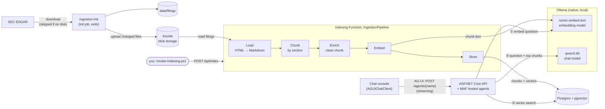

# SEC Filings Agentic RAG

[](https://dotnet.microsoft.com/)
[](https://aspire.dev/)
[](https://learn.microsoft.com/agent-framework/)
[](https://modelcontextprotocol.io/)
[](LICENSE)

Ask questions about publicly listed companies and get answers **grounded in their actual SEC 10-K filings, with citations**. Everything runs on your own laptop.

> *"What are NVIDIA's main risk factors?"*
> *"Compare how Apple and Microsoft describe their revenue drivers."*

It consists of:

1. **A RAG pipeline** (Retrieval-Augmented Generation):
   - an *indexing phase* that turns filings into searchable chunks;
   - a *query phase* that finds the most relevant chunks for a question.
2. **An AI agent** that starts as a plain chatbot, adds standard RAG, then becomes **agentic RAG**, where the model decides for itself what to search, how often, and with which filters.

> **Status:** phases 0–8 are implemented: ingestion, indexing, retrieval, three agents, retrieval-quality evals, production hardening and an MCP server. Phases 9–14 are planned. See the [roadmap](#roadmap).

## Features

- **Three agents behind one API** (AG-UI protocol): `chat-only` (baseline), `standard-rag` (retrieve before every answer) and `agentic-rag` (the model plans its own searches with ticker, form-type and fiscal-year filters).
- **End-to-end RAG pipeline:** SEC EDGAR download → HTML-to-Markdown → section-aware chunking → cleaning and prompt-injection flagging → local embeddings → Postgres + pgvector.
- **Configurable retrieval strategies:** vector, hybrid (pgvector + Postgres full-text, fused with Reciprocal Rank Fusion), LLM reranking and multi-query rewriting. Each one is switched on by configuration, not code changes.
- **Evaluation harness:** a golden dataset with Hit@k, MRR and Recall@k across every retrieval configuration, plus LLM-judged answer relevance, groundedness and completeness, and tool-use checks for the agentic agent ([results](#evaluation)).
- **MCP server:** tools (`search_filings`, `list_available_filings`), resources (filing catalog, outlines, full Item text) and prompts. `agentic-rag` consumes it over MCP, and VS Code Copilot and Claude Desktop can use it too.
- **Production hardening:** persistent conversations, OpenTelemetry traces and metrics, resilience pipelines, rate limiting, request limits, topic guardrails and citation enforcement.
- **Fully local by default:** Ollama models, Docker containers and an Aspire dashboard. A config switch moves chat to a cloud OpenAI-compatible model.

---

## How it works



The same embedding model (`nomic-embed-text`) embeds both the chunks and the question. That's why the question's vector can be compared with the chunks' vectors. Only the final step, writing the answer, goes to the chat model (`qwen3:4b`). Both models are defaults; you can change them in configuration.

The flow in five steps:

1. **Ingest (automatic, on start).** The **IngestionInit** init job downloads the latest 10-K filings (HTML) for five companies from SEC EDGAR, skipping any already on disk. It uploads them to blob storage (Azurite, the local Azure Storage emulator), then exits.
2. **Request indexing (you).** Run `./scripts/Invoke-Indexing.ps1` (or the dashboard's "Re-index" command), which calls the **indexing Function**. Until you do, search returns nothing.
3. **Index.** The Function runs Microsoft's DataIngestion `IngestionPipeline` on each filing:
   1. **Load:** convert the HTML to Markdown.
   2. **Chunk:** split by section ("Item 1A. Risk Factors", …).
   3. **Enrich:** clean each chunk. This is the enrichment phase of Microsoft's RAG guide: normalization, boilerplate removal and prompt-injection flagging.
   4. **Embed:** `nomic-embed-text` turns the cleaned text into an *embedding*, a list of 768 numbers that captures its meaning.
   5. **Store:** save chunks and vectors in **Postgres + pgvector**.

   In code, one `VectorStoreWriter` performs the last two steps.
4. **Retrieve and answer.** When you ask a question, the **API** (one AG-UI endpoint per agent: `chat-only`, `standard-rag`, `agentic-rag`) does three things:
   1. It embeds the question with **`nomic-embed-text`**.
   2. It finds the most similar chunks in pgvector.
   3. It sends the question plus those chunks to **`qwen3:4b`**, which writes an answer that cites its sources.

   `chat-only` skips the first two steps. `agentic-rag` lets the model decide when and what to search.
5. **Orchestrate.** **Aspire** starts everything in the right order: databases, the init job, the indexing Function and the API. Its dashboard shows logs and traces.

## Tech stack

| Concern | Technology |
|---|---|
| Language / runtime | C# / .NET 10 |
| Orchestration | Aspire (AppHost + dashboard) |
| LLM and embeddings | Ollama, run natively. Default models: `qwen3:4b` (chat and tools), `nomic-embed-text` (embeddings). Both are configurable. |
| AI abstractions | Microsoft.Extensions.AI (`IChatClient`, keyed `IEmbeddingGenerator`, middleware, `GetResponseAsync<T>`), Microsoft.ML.Tokenizers |
| Agent | Microsoft Agent Framework (`ChatClientAgent`, `TextSearchProvider`, function tools, middleware, hosting + `AgentSessionStore`, AG-UI, evaluation) |
| Indexing building blocks | Microsoft.Extensions.DataIngestion (`IngestionPipeline`, readers, chunkers, `VectorStoreWriter`) |
| Vector database | PostgreSQL + pgvector (Docker), via Microsoft.Extensions.VectorData (`IVectorSearchable` is the query contract) |
| Document storage | Azure Blob Storage SDK against Azurite (Docker) |
| Indexing host | Azure Functions (isolated worker, HTTP trigger) |
| Query host | ASP.NET Core minimal API; agents served over the **AG-UI** protocol (`MapAGUI`) |
| Client | Console app on `AGUIChatClient` (any AG-UI client, e.g. a React UI, works too) |

## Design highlights

- **The indexing and query libraries are host-agnostic.** `SECFilingsAgenticRag.IngestionPipeline` runs inside an Azure Function, but could equally run from a CLI or a web app. `SECFilingsAgenticRag.RetrievalPipeline` uses the **built-in** `IVectorSearchable<T>` contract plus one search function, which the standard-RAG context provider, the agent tool, an HTTP endpoint and an MCP server all call.
- **The agentic agent gets its tools over MCP** (Phase 8). A separate MCP server serves `search_filings` and `list_available_filings`, plus resources (filing catalog, outlines, full Item text) and prompts (risk review, company comparison, Item summary). `agentic-rag` discovers and calls the tools through an MCP client, and VS Code Copilot or Claude Desktop use the same server.
- **Built-in first.** The SDK abstractions are used directly (MEAI, VectorData, DataIngestion, ML.Tokenizers, Agent Framework hosting / AG-UI / middleware). Every remaining custom type is listed with the reason no built-in fits ([docs/01 §5.8](docs/01-architecture-and-design.md#58-custom-types-and-why-no-built-in-fits)).
- **Open/Closed by design.** Hybrid search, reranking, multi-query, a PDF reader and new agents are each added as **new classes or registrations switched on by configuration**, not by editing existing code.
- **Model names are configuration, not code.** Defaults live in `appsettings.json`, and environment variables override them (e.g. `AI__Chat__Model=qwen3:8b`). A config switch can move the chat model to a cloud provider (OpenAI-compatible) for faster demos, while embeddings stay local.
- **Measured, not guessed.** An eval runner compares retrieval strategies (vector, hybrid, reranked) on a golden question set, using Hit@k, MRR and Recall@k, plus answer relevance and groundedness.

## Getting started

### Prerequisites

| Tool | Check |
|---|---|
| .NET 10 SDK | `dotnet --list-sdks` |
| Docker Desktop (running) | `docker info` |
| Ollama | `ollama --version` |
| Azure Functions Core Tools v4 | `func --version` |
| Aspire CLI 13.x | `aspire --version` |
| PowerShell 7.3+ | `$PSVersionTable.PSVersion` |

```powershell
ollama pull qwen3:4b
ollama pull nomic-embed-text
```

> Runs on CPU on a typical 16 GB laptop. Indexing five 10-Ks takes minutes, and an answer can take tens of seconds. That's expected.

### Run it

```powershell
git clone https://github.com/sushyk/SECFilingsAgenticRag.git
cd SECFilingsAgenticRag

# 1. Once: SEC requires your name and email in the User-Agent. Stored as an AppHost user-secret.
dotnet user-secrets set "Parameters:sec-user-agent" "Your Name you@example.com" --project src/SECFilingsAgenticRag.AppHost

# 2. Start everything. The ingestion-init job downloads (first run only) and uploads filings, then exits.
aspire run          # interactive, opens the dashboard; Ctrl+C to stop

# 3. In a second terminal, request indexing. Minutes the first time; seconds when nothing changed.
./scripts/Invoke-Indexing.ps1

# 4. Chat. Pick the agent per run: chat-only | standard-rag (default) | agentic-rag
dotnet run --project src/SECFilingsAgenticRag.AgentClient.Cli -- --agent agentic-rag
```

**Use the MCP server from VS Code.** While the app runs, the repo's [.vscode/mcp.json](.vscode/mcp.json) connects Copilot Chat to the MCP server's `search_filings` and `list_available_filings` tools.

### Configuration

| Setting | Where | Override example |
|---|---|---|
| Chat model | AppHost `appsettings.json` → `Parameters:chat-model` | `${env:Parameters__chat-model} = "qwen3:8b"` |
| Embedding model | AppHost `Parameters:embedding-model` (dimensions are fixed at 768 in code) | must produce 768 dimensions; drop `sec_filing_chunks` and re-index afterwards |
| Agent | chosen per request by URL (`/agents/chat-only`, `/agents/standard-rag`, `/agents/agentic-rag`); AgentClient.Cli `--agent` | `--agent agentic-rag` |
| Retrieval strategy | AgentServer `appsettings.json` → `Retrieval:Strategy`, `Retrieval:Rerank:Enabled` | `$env:Retrieval__Strategy = "Hybrid"` |
| Cloud chat (optional) | `chat-provider`, `chat-endpoint`, `chat-api-key` (secret) | set via `dotnet user-secrets` on the AppHost |

## Operating the system

**Start everything headlessly** (Docker Desktop and native Ollama running; the Aspire CLI must match the AppHost's 13.6.x):

```powershell
aspire start; aspire wait ingestion-init --status down --timeout 3600; aspire wait indexing
./scripts/Invoke-Indexing.ps1
aspire wait api
dotnet run --project src/SECFilingsAgenticRag.AgentClient.Cli -- --agent agentic-rag --ask "What are NVIDIA's main risk factors?"
aspire stop
```

**Where telemetry lives.** Everything goes to the Aspire dashboard (the `aspire start` output prints its URL): **Traces**, **Metrics**, **Structured logs**. From a terminal: `aspire otel traces api`, `aspire otel spans api --trace-id <id> --format Json`, `aspire otel logs api`.

**Debugging a slow or bad answer.** Find the `POST /agents/<agent>` trace with the longest duration. One trace holds the whole run:

| Span | What it tells you |
|---|---|
| `invoke_agent <agent>` | the whole run; `secfilings.agent`, `secfilings.refused` |
| first `chat <model>` (short output) | the topic guard |
| `compaction.*` | context compaction before each model call |
| `execute_tool search_filings` | an agentic-rag tool call |
| `retrieval.search` | `secfilings.strategy`, `secfilings.top`, `secfilings.ticker`, `secfilings.result_count`, `secfilings.top_score` |
| `embeddings <model>` → `POST /api/embed` | the query embedding |
| `postgresql` | the SQL, including the session load and save |
| `chat <model>` → `POST /api/chat` | each model call; time to headers is prompt processing |

Metrics: `secfilings.chat.turns` (agent, refused), `secfilings.chat.duration`, `secfilings.retrieval.duration` (strategy), `secfilings.ingestion.documents` (status), `secfilings.ingestion.duration`, and the built-in `gen_ai.client.token.usage`. To see prompts and responses in traces for one local debugging session only, set `$env:Telemetry__EnableSensitiveData = "true"` (or `OTEL_INSTRUMENTATION_GENAI_CAPTURE_MESSAGE_CONTENT=true`) before starting, and remove it afterwards. It is off in every config file because traces would then hold user questions and filing text.

**Conversations** are stored in Postgres table `agent_sessions`, one row per `(agent, AG-UI thread id)`, and survive API restarts. The `turns` column counts saved runs.

**Changing models** is configuration only (env vars override `appsettings.json`; under Aspire set the AppHost parameter before `aspire start`):

| What | Aspire | Without Aspire |
|---|---|---|
| Chat model | `${env:Parameters__chat-model} = "llama3.2"` | `AI__Chat__Model` |
| Embedding model | `${env:Parameters__embedding-model}` | `AI__Embedding__Model` (re-index) |
| Context window / Ollama attempt timeout | — | `AI__Chat__ContextLength`, `AI__Chat__TimeoutSeconds` |
| Reranker / query rewriter / topic guard | — | `Retrieval__Rerank__Model`, `Retrieval__MultiQuery__Model`, `Guardrails__TopicGuard__Model` |
| Eval judge | — | `Evals__Judge__Model` |

`/health` (Development only) reports **Degraded** with the model name when Ollama hasn't pulled a configured model, and **Unhealthy** when Ollama is unreachable.

**Guardrails** (AgentServer `appsettings.json`): `Agent:MaxInputTokens` (1000) answers "too long" for longer messages. `Guardrails:TopicGuard:Enabled` adds one classifier call per message, which refuses off-topic questions and investment advice. Set it to `false` for faster demos. `Guardrails:RequireCitations` appends a note to RAG answers that cite nothing. Retrieved text is always fenced and escaped.

**Limits:** 30 chat requests per minute per IP (`RateLimiting:Chat`) → 429. Request bodies over 64 KB on `/agents/*` (`Api:MaxRequestBytes`) → 413. A chat run times out after 900 s (`Api:ChatTimeoutSeconds`), `/api/search` after 120 s, everything else after 30 s.

**Resetting data:** `aspire stop`, then `docker rm -f` the `postgres-*` and `storage-*` containers and `docker volume rm` their `secfilingsagenticrag.apphost-*` volumes, then delete `data\filings`. To forget conversations only, run `DROP TABLE agent_sessions;` (it is recreated on first use).

**Known limitations:** no authentication and a single tenant. Anyone who can reach port 5180 can chat and resume any thread id. Anyone who can reach port 5190 can call the MCP server's tools, resources and prompts. Conversations are kept forever (no retention job), and compaction bounds only what is sent to the model, not what is stored.

## Evaluation

Retrieval quality is measured, not guessed. The eval runner ([evals/SECFilingsAgenticRag.Evals](evals/SECFilingsAgenticRag.Evals)) scores each retrieval configuration on a **golden dataset of 25 questions** (single-company and cross-company) over **5 indexed 10-Ks (824 chunks)**. Embeddings come from `nomic-embed-text`. The reranker and query rewriter are `llama3.2` (3B), running locally on CPU.

| Config | Hit@5 | Hit@10 | MRR@10 | Recall@5 | Recall@10 | p50 ms | p95 ms |
| --- | --- | --- | --- | --- | --- | --- | --- |
| Vector | 0.60 | 0.76 | 0.40 | 0.56 | 0.72 | 50 | 78 |
| **Hybrid** (vector + full-text, RRF) | **0.64** | **0.80** | **0.46** | **0.60** | **0.76** | 59 | 122 |
| Hybrid + MultiQuery | 0.44 | 0.60 | 0.27 | 0.42 | 0.58 | 4,082 | 6,109 |
| Vector + Rerank | 0.24 | 0.32 | 0.16 | 0.22 | 0.28 | 60,741 | 187,022 |
| Hybrid + Rerank | 0.28 | 0.36 | 0.20 | 0.26 | 0.32 | 75,438 | 223,212 |

What the numbers show:
- **Hybrid search is the best default.** MRR rises from 0.40 to 0.46 (relevant chunks rank higher) for about 10 ms extra at p50.
- **LLM reranking and multi-query rewriting hurt with a 3B local model.** They are slower by orders of magnitude and less accurate. The model can't reliably judge relevance or produce useful rewrites. Both stay opt-in behind configuration and are worth re-testing with a larger or cloud model.
- **The misses are informative.** Most failed questions ask for headcounts, which 10-Ks state in one sentence that rarely matches the query wording. That makes them a natural target for [LLM chunk augmentation](docs/specs/phase-14-llm-chunk-augmentation.md).
- With 25 questions, ±0.04 is a single question. So only the MRR gain and the rerank/multi-query losses are clearly beyond noise.

**Answer quality** is scored with Microsoft.Extensions.AI.Evaluation (Relevance, Groundedness, Completeness), and agent tool use is checked with Agent Framework evaluators. In a 5-question smoke run, with `llama3.2` as both agent and judge:

| Agent | Groundedness | Completeness | Avg tool calls | Answers citing sources |
|---|---|---|---|---|
| standard-rag | 4.00 / 5 | 3.40 / 5 | 0.0 | 100% |
| agentic-rag | 4.00 / 5 | 3.33 / 5 | 1.0 | 100% |

For agentic-rag, 5/5 answers called the search tool with valid arguments and 4/5 cited only sources the tools returned. These scores are indicative only: the evaluators' prompts are tuned for GPT-4o, and a small local judge often fails to produce a parseable score. Use the cloud judge for real numbers.

Reproduce the evaluation (with the app running and indexed):

```powershell
dotnet run --project evals/SECFilingsAgenticRag.Evals -- retrieval --configs "Vector,Hybrid,Hybrid+MultiQuery,Vector+Rerank,Hybrid+Rerank"
dotnet run --project evals/SECFilingsAgenticRag.Evals -- answers --agent standard-rag,agentic-rag --limit 5
dotnet aieval report --path evals/results/store --output evals/results/report.html --open
```

Full results and analysis are in [evals/results/sample-retrieval.md](evals/results/sample-retrieval.md) and [docs/notes/phase-06-notes.md](docs/notes/phase-06-notes.md).

## Roadmap

| Phase | Status | Delivers | Spec |
|---|---|---|---|
| 0 | ✅ | Solution foundation, Aspire with Postgres/pgvector and Azurite, shared contracts | [phase-00](docs/specs/phase-00-foundation.md) |
| 1 | ✅ | `ingestion-init` init job: EDGAR download + upload to blob storage | [phase-01](docs/specs/phase-01-ingestion-init.md) |
| 2 | ✅ | **RAG indexing phase**: Azure Function (MEDI `IngestionPipeline`) chunks, cleans and embeds into pgvector; `Invoke-Indexing.ps1` | [phase-02](docs/specs/phase-02-ingestion-pipeline.md) |
| 3 | ✅ | **RAG query phase**: retrieval library + `/api/search` | [phase-03](docs/specs/phase-03-retrieval-pipeline.md) |
| 4 | ✅ | Chat agents over **AG-UI** (chat-only, **standard RAG**) + console client | [phase-04](docs/specs/phase-04-chat-api-and-standard-rag.md) |
| 5 | ✅ | **Agentic RAG**: tools, filters, multi-step search | [phase-05](docs/specs/phase-05-agentic-rag.md) |
| 6 | ✅ | Hybrid search, reranking, multi-query + **evals** | [phase-06](docs/specs/phase-06-retrieval-quality-and-evals.md) |
| 7 | ✅ | Production hardening: persistence, tracing, resilience, guardrails | [phase-07](docs/specs/phase-07-production-hardening.md) |
| 8 | ✅ | **MCP server** (tools, resources, prompts); `agentic-rag` calls its tools over MCP | [phase-08](docs/specs/phase-08-mcp-server.md) |
| 9 | Planned | Automated tests | [phase-09](docs/specs/phase-09-tests.md) |
| 10 | Planned | PDF filings reader (Open/Closed showcase) | [phase-10](docs/specs/phase-10-pdf-reader.md) |
| 11 | Planned | XBRL financial-numbers tool | [phase-11](docs/specs/phase-11-xbrl-financial-metrics.md) |
| 12 | Planned | React + Vite web UI | [phase-12](docs/specs/phase-12-web-ui.md) |
| 13 | Planned | Asynchronous (queue-based) indexing | [phase-13](docs/specs/phase-13-async-indexing.md) |
| 14 | Planned | LLM chunk augmentation | [phase-14](docs/specs/phase-14-llm-chunk-augmentation.md) |

## How it was built

The project was developed agent-first, with AI coding agents (Claude Code) steered by a human, in the order a real team would follow:
1. **Research and design.** The [architecture](docs/01-architecture-and-design.md) and [Microsoft guidance alignment](docs/02-microsoft-guidance-alignment.md) documents, then one spec per phase in [docs/specs](docs/specs), each with acceptance checks.
2. **Implementation, phase by phase.** Each phase is implemented against its spec and verified. Its notes ([docs/notes](docs/notes)) record what was built, the exact SDK APIs used, deviations from the spec, and verification results.
3. **Guardrails for the agents.** [CLAUDE.md](CLAUDE.md) sets the coding and commit rules, and [.claude/skills](.claude/skills) gives the agents Aspire and Microsoft Agent Framework know-how.

## Documentation

- [docs/01-architecture-and-design.md](docs/01-architecture-and-design.md): architecture, contracts, extension points, decision log.
- [docs/02-microsoft-guidance-alignment.md](docs/02-microsoft-guidance-alignment.md): how [Microsoft's RAG solution design and evaluation guide](https://learn.microsoft.com/azure/architecture/ai-ml/guide/rag/rag-solution-design-and-evaluation-guide) and the Microsoft Learn SDK docs shaped each design decision, plus an evidence log.
- [docs/specs](docs/specs): one spec per phase. [docs/notes](docs/notes): implementation notes per phase.

## Repository layout

```
src/       SECFilingsAgenticRag.* : AppHost, ServiceDefaults, Common, IngestionInit, IngestionPipeline (+ .Functions host),
           RetrievalPipeline, AgentServer, McpServer, AgentClient.Cli
evals/     retrieval and answer-quality evaluation runner, golden dataset, sample results
scripts/   Invoke-Indexing.ps1 (request indexing)
docs/      architecture, Microsoft guidance alignment, phase specs and notes
.claude/   agent skills used during development
data/      downloaded filings (git-ignored)
```

## License

[MIT](LICENSE)

## Disclaimer

This is a demo for learning purposes. Answers are generated by language models from SEC filings and may be incomplete or wrong. **Nothing here is investment advice.**
