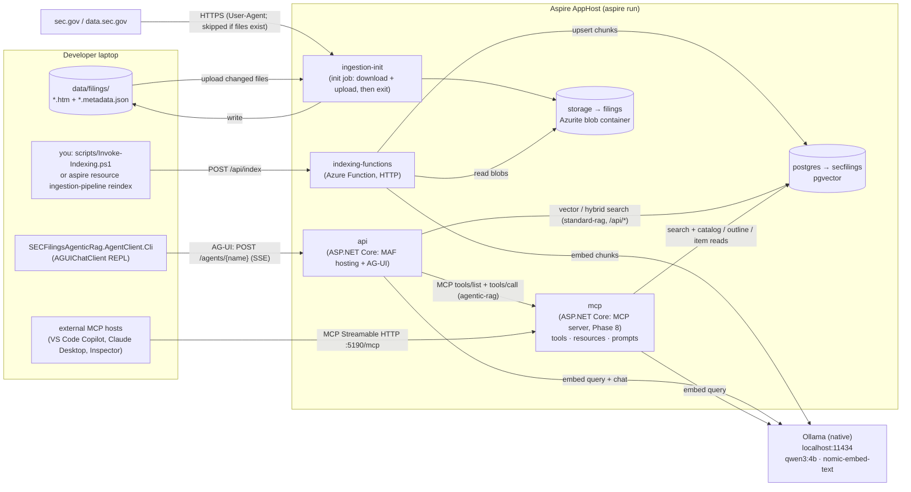
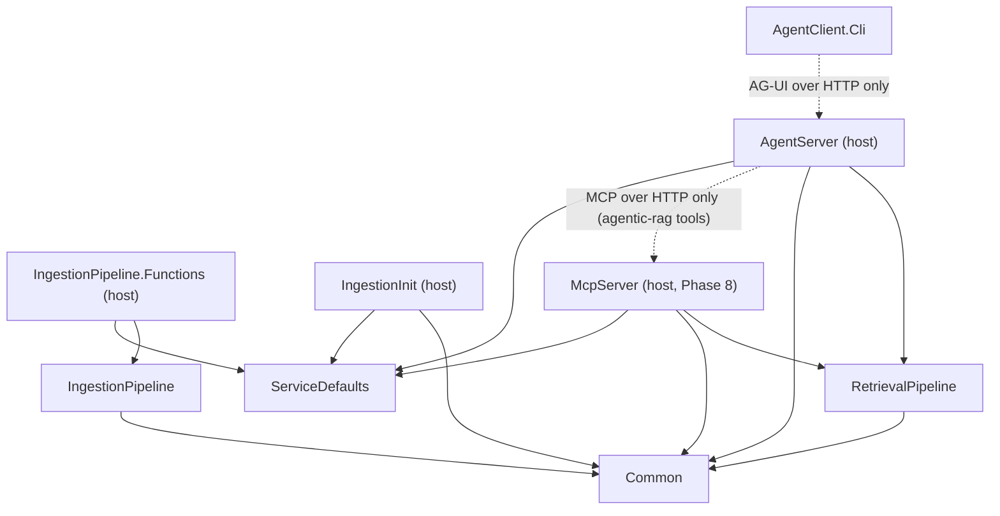

# 02: Architecture and code design

> Audience: you (the learner) and the agents implementing each phase.
> This document is the **source of truth for project design and contracts** (type names, signatures, config keys, resource names). Every phase spec copies the parts it needs. If a spec and this document disagree, this document wins. If code already on disk disagrees with both, the code on disk wins and the doc should be updated.
>
> **Microsoft Learn is authoritative for facts about Microsoft SDK/API behavior and RAG concepts.** That covers Microsoft.Extensions.AI, VectorData, DataIngestion, Agent Framework, Aspire, Azure Functions and the Azure SDKs, plus terminology and phase order from the [Azure Architecture Center RAG guide](https://learn.microsoft.com/azure/architecture/ai-ml/guide/rag/rag-solution-design-and-evaluation-guide). On a conflict about an API fact, **Learn wins** and this document gets corrected. Record the conflict in the phase notes' evidence table.
>
> **Built-in first.** Use the SDK abstractions directly: Microsoft.Extensions.AI, Microsoft.Extensions.VectorData, Microsoft.Extensions.DataIngestion, Microsoft.ML.Tokenizers, Microsoft Agent Framework (hosting, AG-UI, middleware, `AgentSessionStore`, compaction, evaluation), plus Aspire / ASP.NET Core. Don't add a custom interface, wrapper, base class or framework when a built-in type covers the need. Every custom type is listed, with the reason, in [§5.8 Custom types and why no built-in fits](#58-custom-types-and-why-no-built-in-fits).

---

## 1. What we are building

An **SEC filings assistant**. You ask questions like *"What are Apple's biggest supply-chain risks?"* or *"Compare how Microsoft and Amazon describe AI competition"*. The system answers **only from real 10-K filings**, with citations.

The system has two halves, matching the two phases of RAG:

| Half | When it runs | What it does | Hosted in |
|---|---|---|---|
| **Ingestion** (offline, once per start) | When Aspire starts | Download filings from EDGAR (skipped if already on disk) → upload changed files to blob storage → exit | `SECFilingsAgenticRag.IngestionInit` init job |
| **Indexing** (offline, on request) | When **you** call the indexing Function (`scripts/Invoke-Indexing.ps1` or the `reindex` command) | Convert HTML to Markdown → split into chunks → clean each chunk → embed → store vectors and metadata in Postgres/pgvector | `SECFilingsAgenticRag.IngestionPipeline` library (MEDI `IngestionPipeline<string>`), called by an **Azure Function** (HTTP trigger) |
| **Query** (online) | Every time a user asks something | Embed the question → find the most similar chunks → give them to the LLM → stream the answer with citations | `SECFilingsAgenticRag.RetrievalPipeline` + `SECFilingsAgenticRag.AgentServer` libraries, called by the **ASP.NET Core API** |

Everything runs on one Windows laptop, orchestrated by **Aspire**:

- **Postgres + pgvector** runs in Docker and is the vector database.
- **Azurite** runs in Docker and emulates Azure Blob Storage; it stores the raw filings.
- **Ollama** runs natively on Windows and hosts the local models:
  - `qwen3:4b` is the chat model, which can also call tools;
  - `nomic-embed-text` is the embedding model, producing 768-dimension vectors.

---

## 2. System diagram



Startup order, and when indexing happens:

```mermaid
sequenceDiagram
    participant AH as AppHost
    participant PG as postgres
    participant AZ as storage (Azurite)
    participant I as ingestion-init (init job)
    participant F as indexing-functions (Function)
    participant M as mcp (Phase 8)
    participant A as api
    actor U as you
    AH->>PG: start container
    AH->>AZ: start container
    AH->>I: start (WaitFor filings)
    I->>I: download missing filings from EDGAR (skipped when on disk)
    I->>AZ: upload new or changed filings
    I-->>AH: exit code 0
    AH->>F: start (WaitFor postgres, storage)
    AH->>M: start (WaitFor postgres)
    AH->>A: start (WaitFor postgres; references mcp)
    Note over A: agentic-rag connects to mcp lazily, on its first run
    Note over A,M: index is empty until you index
    U->>F: POST /api/index (Invoke-Indexing.ps1 or the reindex command)
    F-->>U: IndexingReport (indexed / skipped / failed)
```

**IngestionInit is an *init job*** (the Kubernetes *init container* pattern). It runs once to completion and stages the source documents, and only then is indexing requested.
- It is **not a sidecar**: it doesn't keep running next to another service.
- It is **not a "seeder"**: it was renamed from `Seeder`, because seeding implies loading database test data, while this job *acquires and stages source documents*. Microsoft's RAG guide describes this step as "documents are pushed or pulled into a data pipeline".
- It **never calls the indexing Function.** The user requests indexing, so the expensive step is explicit, observable and repeatable. `aspire wait ingestion-init-job --status down` tells you the documents are in place.

---

## 3. Solution layout

```
SECFilingsAgent/
├─ SECFilingsAgenticRag.slnx
├─ global.json                    # pins .NET SDK 10.0.4xx (rollForward latestFeature)
├─ Directory.Build.props          # net10.0, nullable, implicit usings, warnings
├─ Directory.Packages.props       # central package versions (CPM); ALL Aspire.* + the AppHost SDK attribute on one version
├─ CLAUDE.md                      # coding rules every agent must follow; maintained by the user by hand (agents never edit it)
├─ data/filings/                  # git-ignored; produced by the IngestionInit download step
├─ docs/                          # these documents, specs/ and notes/
├─ src/
│  ├─ SECFilingsAgenticRag.AppHost/                      # Aspire orchestration
│  ├─ SECFilingsAgenticRag.ServiceDefaults/              # Aspire service defaults (OTel, health, resilience)
│  ├─ SECFilingsAgenticRag.Common/                       # shared abstractions: chunk record, metadata, options, AI registration
│  ├─ SECFilingsAgenticRag.IngestionInit/                # init job: EDGAR download (Edgar/) + blob upload, then exit
│  ├─ SECFilingsAgenticRag.IngestionPipeline/            # ingestion pipeline library (host-agnostic)
│  ├─ SECFilingsAgenticRag.IngestionPipeline.Functions/  # Azure Functions host (HTTP trigger) for the ingestion pipeline
│  ├─ SECFilingsAgenticRag.RetrievalPipeline/            # retrieval pipeline library (host-agnostic); Tools/: FilingTools (model-facing tool bodies, Phase 8 moved them here)
│  ├─ SECFilingsAgenticRag.AgentServer/                  # ASP.NET Core: MAF agents (AddAIAgent), guardrail middleware, session store, MCP client for agentic-rag; AG-UI /agents/{name}, /api/search, /api/filings
│  ├─ SECFilingsAgenticRag.McpServer/                    # Phase 8, ASP.NET Core MCP server at /mcp: tools (FilingTools), resources, prompts
│  └─ SECFilingsAgenticRag.AgentClient.Cli/              # console AG-UI client (AGUIChatClient; an Aspire terminal resource)
├─ scripts/
│  └─ Invoke-Indexing.ps1         # the user's way to request indexing (POST /api/index, prints the report)
├─ evals/
│  └─ SECFilingsAgenticRag.Evals/           # retrieval + answer quality evaluation runner
└─ tests/
   ├─ SECFilingsAgenticRag.Common.Tests/
   ├─ SECFilingsAgenticRag.IngestionInit.Tests/
   ├─ SECFilingsAgenticRag.IngestionPipeline.Tests/      
   ├─ SECFilingsAgenticRag.RetrievalPipeline.Tests/
   ├─ SECFilingsAgenticRag.AgentServer.Tests/
   ├─ SECFilingsAgenticRag.McpServer.Tests/              # Phase 8: tools/resources/prompts over an in-memory MCP client
   └─ SECFilingsAgenticRag.IntegrationTests/             # Aspire.Hosting.Testing end-to-end
```

### Dependency rules (enforced by review)



1. **Libraries never reference hosts.** `Common`, `IngestionPipeline` and `RetrievalPipeline` must not reference Aspire, Azure Functions or ASP.NET Core packages. This is what "host agnostic" means: the same ingestion pipeline could be called from a CLI, a Function or a web app. The agents live in `AgentServer`, their only host; tests and evals that run them in-process reference `AgentServer` directly, as `WebApplicationFactory` tests do.
2. **`IngestionPipeline` and `RetrievalPipeline` never reference each other.** They agree only through `Common`. That is the answer to "should indexing and query be in the same library?": no, but they **share a contract**.
3. **Connection-bearing clients are registered by the host, never by a library.** The host decides *where* things live; libraries decide *what to do* with them. This applies to `NpgsqlDataSource`, `BlobContainerClient` and the Ollama endpoint. Hosts use Aspire client integrations, for example `builder.AddNpgsqlDataSource("secfilings", ...)` and `builder.AddAzureBlobContainerClient("filings")`, and libraries resolve those types from DI.
4. Each library exposes one registration entry point: `IServiceCollection AddSecFilingsXxx(this IServiceCollection services, IConfiguration configuration)`. `AgentServer` registers its agents with `AddSecFilingsAgents(this IHostApplicationBuilder)`, because MAF's `AddAIAgent` is an `IHostApplicationBuilder` extension.
5. `AgentClient.Cli` talks to `AgentServer` **only over HTTP, using the AG-UI protocol** (`AGUIChatClient`). A web UI (an AG-UI client such as CopilotKit) works without touching the server.
6. *(Phase 8)* `AgentServer` and `McpServer` never reference each other. `agentic-rag` reaches its tools **only over MCP** (`McpClient` → `/mcp`), and both hosts share the tool bodies through `RetrievalPipeline` (`FilingTools`). A tool added to `McpServer` reaches `agentic-rag` through `tools/list`, with no `AgentServer` change.

---

## 4. Canonical names

### 4.1 Aspire resource names

| Resource | Kind | Name | Notes |
|---|---|---|---|
| Postgres server | container `pgvector/pgvector:pg17` | `postgres` | data volume, so data survives restarts |
| Database | Postgres DB | `secfilings-vector-db` | connection string name used by clients; the physical database stays `secfilings` (`databaseName`) |
| Storage account | Azure Storage, `RunAsEmulator()` (Azurite) | `storage` | data volume; also Functions host storage |
| Blob container | blob container | `filings-blob-container` | holds raw filings; the physical container stays `filings` (`blobContainerName`) |
| Ollama | external connection string | `ollama` | value `Endpoint=http://localhost:11434` in AppHost `appsettings.json` → `ConnectionStrings:ollama` |
| Ingestion pipeline Function (`IngestionPipeline.Functions`) | `AddAzureFunctionsProject` | `ingestion-pipeline` | exposes `POST /api/index` |
| IngestionInit (init job) | project, runs once to completion | `ingestion-init-job` | downloads + uploads, then exits. Nothing waits on it; `aspire wait ingestion-init-job --status down --timeout 3600` |
| AgentServer | project | `agent-server-web-api` | AG-UI agents and `/api/*`; fixed host port **5180** (http), set via `launchSettings.json` `applicationUrl`, so AgentClient.Cli can find it. `WaitFor(db)` only, so search is empty until indexing has run. From Phase 8 it has `WithReference(mcpServer)` (`filings-mcp-server`): `agentic-rag` calls its tools over MCP |
| McpServer (Phase 8) | project, `WithExternalHttpEndpoints` | `filings-mcp-server` | MCP server at `/mcp` (stateless Streamable HTTP): tools, resources, prompts; fixed host port **5190**, so external MCP hosts can find it. `WaitFor(db)`, `WithReference(ollama)`, `WithAIModels` |
| Re-index commands | `WithHttpCommand` on `ingestion-pipeline` | `reindex`, `reindex-force` | explicit `commandName` values (pinned). Run them with `aspire resource ingestion-pipeline reindex` |
| AgentClient.Cli | project, `WithTerminal`, `WaitFor(api)` | `chat-client-cli` | interactive chat in the dashboard's Terminal view or `aspire terminal attach chat-client-cli`; gets the API URL as `SECFILINGS_API`; `/agent <name>` switches agent |
| Evals (Phase 6) | projects, explicit start, `WithAIModels` | `evals-retrieval`, `evals-answers` | started on demand, not at AppHost boot |
| Web UI (Phase 12) | JS app | `web` | React + Vite |

### 4.2 Configuration keys

Configuration is read through the options pattern (`IOptions<T>`) with `ValidateDataAnnotations().ValidateOnStart()`.

**Rule: model names (and every other deployment-specific value) come from configuration, never from code.**

1. **No hard-coded model names in C#.** That covers chat model, embedding model, embedding dimensions, endpoints and judge model. Options classes declare these properties as `[Required]` with **no default value**, so a missing setting fails at startup (`ValidateOnStart`) instead of silently using a baked-in model.
2. **Defaults live in each host's `appsettings.json`.** These hosts each carry the `AI` section: `SECFilingsAgenticRag.IngestionPipeline.Functions`, `SECFilingsAgenticRag.AgentServer`, `SECFilingsAgenticRag.McpServer` (Phase 8) and `evals/SECFilingsAgenticRag.Evals`. IngestionInit needs no AI configuration.
   - For the Functions host, `appsettings.json` must be copied to the output directory (`CopyToOutputDirectory=PreserveNewest`) and loaded explicitly if `FunctionsApplication.CreateBuilder` doesn't load it.
   - Values that only make sense for `func start` outside Aspire may also go in `local.settings.json`.
3. **Environment variables override `appsettings.json`.** The standard .NET configuration order applies (appsettings.json → appsettings.{Environment}.json → user-secrets in Development → environment variables → command line). After deployment, set for example:
   - `AI__Chat__Model=qwen3:8b`
   - `AI__Embedding__Model=nomic-embed-text`
   - `AI__Embedding__Dimensions=768`

   The double underscore `__` maps to the `:` separator.
4. **Under Aspire, one source of truth.** The AppHost declares the models once as parameters in its own `appsettings.json` (`Parameters:chat-model`, `Parameters:embedding-model`, `Parameters:embedding-dimensions`). It injects them into every service with `WithEnvironment("AI__Chat__Model", chatModel)` and so on. That uses the same environment-variable override mechanism, and it guarantees the indexing Function and the API **use the identical embedding model**.
   Full AppHost parameter list:

   | Parameter | Injected as | Introduced in |
   |---|---|---|
   | `chat-model` | `AI__Chat__Model` | 0 |
   | `embedding-model` | `AI__Embedding__Model` | 0 |
   | `embedding-dimensions` | `AI__Embedding__Dimensions` | 0 |
   | `chat-provider` | `AI__Chat__Provider` | 5 |
   | `chat-endpoint` | `AI__Chat__Endpoint` | 5 |
   | `chat-api-key` (secret) | `AI__Chat__ApiKey` | 5 |
   | `sec-user-agent` (required; AppHost user-secrets) | `IngestionInit__Edgar__UserAgent` | 1 |

   Empty `Endpoint` / `ApiKey` values are treated as *unset* when `Provider=Ollama`.
5. **Secrets** (`AI:Chat:ApiKey`) are never put in `appsettings.json`. Use `dotnet user-secrets` locally, or an environment variable or secret store after deployment.

```jsonc
{
  "ConnectionStrings": {
    "ollama": "Endpoint=http://localhost:11434",   // injected by Aspire in hosts
    "secfilings": "<injected by Aspire>",
    "filings": "<injected by Aspire>"
  },
  "AI": {
    "Chat": {
      "Provider": "Ollama",            // Ollama | OpenAICompatible
      "Model": "qwen3:4b",
      "Endpoint": null,                // OpenAICompatible only, e.g. https://models.github.ai/inference
      "ApiKey": null,                  // OpenAICompatible only; use user-secrets, never commit
      "TimeoutSeconds": 600            // local CPU inference is SLOW; keep this long
    },
    "Embedding": {
      "Provider": "Ollama",            // keep embeddings local even if chat goes to the cloud
      "Model": "nomic-embed-text",
      "Dimensions": 768,
      "DocumentPrefix": "search_document: ",   // nomic-embed-text task prefixes
      "QueryPrefix": "search_query: ",
      "BatchSize": 16,                    // the embedding middleware batches inner calls; on the write path the vector store batches per upsert
      "CacheQueries": false,              // true → MEAI UseDistributedCache on the "query" generator (host registers IDistributedCache)
      "TimeoutSeconds": 300,
      "Normalization": {               // SYMMETRIC: applied to documents AND queries by the keyed embedding middleware
        "UnicodeNormalization": true,  // NFKC, NBSP/zero-width, smart quotes, dashes
        "CollapseWhitespace": true,
        "Lowercase": false             // evaluate before enabling (Microsoft RAG enrichment guide)
      }
    }
  },
  "VectorStore": {
    "CollectionPrefix": "filing_chunks"   // final name: filing_chunks_<model>_<dims>
  },
  "Indexing": {
    "MaxTokensPerChunk": 512,
    "OverlapTokens": 64,
    "StagingPath": null,               // default: %TEMP%/secfilings-staging (not part of the fingerprint)
    "Cleaning": {                      // ChunkCleaningProcessor (Phase 2); the whole "Indexing" section is in the fingerprint
      "MarkdownArtifacts": true, "Boilerplate": true, "BoilerplateMinRepeatCount": 5, "BoilerplateMaxLineLength": 80,
      "PromptInjection": true, "PromptInjectionMode": "Flag"   // Flag | Exclude
    }
  },
  "Retrieval": {
    "Strategy": "Vector",              // Vector | Hybrid           (Phase 6 adds Hybrid)
    "DefaultTop": 5,
    "ExcludeInstructionLikeChunks": true,   // filter out chunks flagged by the indexing-time prompt-injection flagger
    "Rerank":    { "Enabled": false, "CandidatePool": 20 },     // Phase 6
    "MultiQuery":{ "Enabled": false, "Variants": 3 },           // Phase 6
    "Hybrid":    { "CandidatePool": 40, "RrfK": 60 }            // Phase 6
  },
  "Agent": {                           // tuning only: the agent is chosen per request by URL (/agents/{name})
    "RetrievalTop": 5, "RecentMessageMemoryLimit": 4,
    "MaxToolIterations": 6,            // Phase 5: FunctionInvokingChatClient.MaximumIterationsPerRequest
    "MaxInputTokens": 1000,            // Phase 7 guardrail (Microsoft.ML.Tokenizers)
    "SessionStore": "InMemory"         // Phase 7: Postgres in AgentServer
  },
  "Mcp": {                             // Phase 8. In AgentServer (MCP client):
    "Endpoint": "http://filings-mcp-server/mcp", // service discovery resolves the host "filings-mcp-server" (the MCP transport rejects https+http://); alone: http://localhost:5190/mcp
    "TimeoutSeconds": 120,             //   HttpClient.Timeout on the "mcp" client; resilience handlers removed (one attempt, no retries)
                                       // In McpServer:
    "MaxResourceTokens": 6000          //   cap on one item resource (protects the client's context window)
  },
  "IngestionInit": {
    "DataPath": "<absolute path to data/filings, set by AppHost>",
    "Edgar": { "Enabled": true, "Tickers": ["AAPL","MSFT","NVDA","AMZN","TSLA"], "FormType": "10-K", "Count": 1,
               "MaxRequestsPerSecond": 8, "UserAgent": "<injected from the sec-user-agent parameter>" }
  }
}
```

---

## 5. Contracts (the code skeleton)

Signatures are shown in C#. Bodies are omitted. Namespaces follow folders, e.g. `SECFilingsAgenticRag.Common.Filings`.

### 5.1 `SECFilingsAgenticRag.Common`: shared by everyone

```csharp
namespace SECFilingsAgenticRag.Common.Filings;

/// Metadata for one filing. Written by the IngestionInit download step as <accession>.metadata.json,
/// copied into blob metadata by the IngestionInit job, and copied onto every chunk by the indexer.
public sealed record FilingMetadata(
    string Ticker,            // "AAPL" (upper-case)
    string CompanyName,       // "Apple Inc."
    string Cik,               // "0000320193" (10 digits, zero-padded)
    string FormType,          // "10-K"
    string AccessionNumber,   // "0000320193-25-000079"
    DateOnly FilingDate,      // date filed with the SEC
    DateOnly ReportDate,      // period of report (fiscal year end)
    int FiscalYear,           // ReportDate.Year
    string PrimaryDocument,   // "aapl-20250927.htm"
    string SourceUrl)         // https://www.sec.gov/Archives/edgar/data/320193/000032019325000079/aapl-20250927.htm
{
    /// Stable id for the filing document, e.g. "AAPL/10-K/0000320193-25-000079".
    public string DocumentId => $"{Ticker}/{FormType}/{AccessionNumber}";
}

/// Blob naming + blob-metadata key conventions shared by IngestionInit and Indexing.
public static class FilingBlobConventions
{
    public static string BlobName(FilingMetadata m, string extension) => $"{m.DocumentId}{extension}"; // "AAPL/10-K/0000320193-25-000079.htm"
    // Blob metadata keys (lower-case ASCII; values ASCII-safe; CompanyName is URL-encoded):
    public const string Ticker = "ticker", CompanyName = "companyname", Cik = "cik", FormType = "formtype",
        Accession = "accession", FilingDate = "filingdate", ReportDate = "reportdate", FiscalYear = "fiscalyear",
        PrimaryDocument = "primarydocument", SourceUrl = "sourceurl",
        ContentSha256 = "contentsha256";     // hex SHA-256 of the file bytes, computed by the IngestionInit job
    public static IDictionary<string, string> ToBlobMetadata(FilingMetadata m, string contentSha256);
    public static FilingMetadata FromBlobMetadata(IDictionary<string, string> metadata);
}
```

```csharp
namespace SECFilingsAgenticRag.Common.VectorStore;

/// One chunk of one filing, as stored in pgvector. WRITTEN by MEDI's VectorStoreWriter<string> (Phase 2), READ by Retrieval.
/// The table schema is the writer's (private, preview): key / content / context / documentid / embedding, plus one column
/// per chunk.Metadata entry (lower-cased storage name). This typed record MIRRORS that schema via StorageName and is
/// pinned by WriterSchemaContractTests: if a MEDI update renames a column, that test fails, not production.
/// We store ONLY the cleaned chunk (Microsoft's guide makes keeping the original an optional extra field; we skip it).
public sealed class FilingChunkRecord
{
    public Guid Key { get; set; }                 // "key": writer-generated random Guid (NOT stable across re-index)
    public string Text { get; set; } = "";        // "content": the CLEANED chunk: stored, embedded, returned, cited, shown to the LLM
    public string? Context { get; set; }          // "context": MEDI chunk context (heading path), may be null
    public string DocumentId { get; set; } = "";  // "documentid" (indexed): FilingMetadata.DocumentId = IngestionDocument.Identifier
    // ---- metadata columns (chunk.Metadata keys, lower-case storage names; present and NON-NULL on every chunk) ----
    public string Ticker { get; set; } = "";      // "ticker" (IsIndexed)
    public string CompanyName { get; set; } = ""; // "companyname"
    public string Cik { get; set; } = "";         // "cik"
    public string FormType { get; set; } = "";    // "formtype" (IsIndexed)
    public int FiscalYear { get; set; }           // "fiscalyear" (IsIndexed)
    public DateTime FilingDate { get; set; }      // "filingdate": DateTimeKind.Utc (Npgsql requires UTC for timestamptz)
    public string Section { get; set; } = "";     // "section": e.g. "Item 1A. Risk Factors"
    public int ChunkIndex { get; set; }           // "chunkindex": 0..n-1 after cleaning/renumbering
    public int ChunkCount { get; set; }           // "chunkcount": n, used by the up-to-date check
    public string IndexFingerprint { get; set; } = ""; // "indexfingerprint": source SHA-256 + relevant config sections (§5.2)
    public bool ContainsInstructionLikeText { get; set; } // "containsinstructionliketext" (IsIndexed): prompt-injection flag; retrieval excludes by default
    public string SourceUrl { get; set; } = "";   // "sourceurl": EDGAR URL, used for citations
    public string EmbeddingModel { get; set; } = ""; // "embeddingmodel"
    public ReadOnlyMemory<float>? Embedding { get; set; } // "embedding": dims, CosineSimilarity (score = similarity, higher is better), Hnsw
}

/// Metadata keys the indexer stamps on EVERY chunk (exact strings; the writer lower-cases storage names anyway).
public static class FilingChunkMetadataKeys
{
    public const string Ticker = "ticker", CompanyName = "companyname", Cik = "cik", FormType = "formtype",
        FiscalYear = "fiscalyear", FilingDate = "filingdate", Section = "section", ChunkIndex = "chunkindex",
        ChunkCount = "chunkcount", IndexFingerprint = "indexfingerprint",
        ContainsInstructionLikeText = "containsinstructionliketext", SourceUrl = "sourceurl", EmbeddingModel = "embeddingmodel";
}

/// Builds the read-side schema at runtime so the vector dimension and collection name follow configuration
/// (switching embedding model => new collection, never a silently-mixed one).
public static class FilingChunkSchema
{
    public const int MaxIdentifierLength = 63;   // Postgres identifier limit
    public static VectorStoreCollectionDefinition CreateDefinition(int dimensions);
    // Key "key" (Guid) | Data with StorageName as listed on FilingChunkRecord (DocumentId, Ticker, FormType, FiscalYear,
    // ContainsInstructionLikeText marked IsIndexed) | Vector "embedding", dimensions, CosineSimilarity, Hnsw.
    // MUST be compatible with the table VectorStoreWriter creates (verified by WriterSchemaContractTests).
    /// THE table-name accessor: used for VectorStoreWriterOptions.CollectionName AND all raw SQL
    /// (psql checks, Phase 5 catalog, Phase 6 hybrid keyword SQL), never a literal.
    public static string CollectionName(VectorStoreOptions store, EmbeddingOptions embedding);
    // => "filing_chunks_nomic_embed_text_768" for the default config (lower-case; non-alphanumerics -> '_';
    //    if > 63 chars: truncate to 54 + "_" + 8 hex chars of SHA-256(full name)). Column names are the writer's
    //    lower-case storage names ("content", "documentid", "ticker", …); verify quoting with \d+ and record it.
}

/// Namespace pinned: SECFilingsAgenticRag.Common.VectorStore.
public sealed class VectorStoreOptions { /* VectorStore */ public string CollectionPrefix = "filing_chunks"; }

/// Custom (no built-in fits): MEVD/Aspire don't run CREATE EXTENSION inside the database. One static call at host startup;
/// the collection itself is created with the built-in EnsureCollectionExistsAsync (AgentServer) or by VectorStoreWriter (Function).
public static class PgVectorSetup { public static Task EnsureExtensionAsync(NpgsqlDataSource dataSource, CancellationToken ct = default); }

public static class VectorStoreServiceCollectionExtensions
{
    /// Requires an NpgsqlDataSource (built with UseVector()) to be registered by the host.
    /// Registers PostgresVectorStore whose EmbeddingGenerator is the KEYED generator `embeddingKey`
    /// (EmbeddingKeys.Document on the Function, EmbeddingKeys.Query on query-side hosts) — same table, two generators —
    /// and VectorStoreCollection<Guid, FilingChunkRecord> (singleton).
    public static IServiceCollection AddSecFilingsVectorStore(this IServiceCollection services, IConfiguration configuration, string embeddingKey);
}
```

```csharp
namespace SECFilingsAgenticRag.Common.AI;

// Bound from configuration (host appsettings.json, overridable by env vars such as AI__Chat__Model).
// Model / Provider / Dimensions are [Required] with NO code defaults — see §4.2 rule.
public sealed class ChatModelOptions      { /* AI:Chat section */  [Required] public string Provider, Model; public string? Endpoint, ApiKey; public int TimeoutSeconds = 600; }
public sealed class EmbeddingOptions      { /* AI:Embedding    */  [Required] public string Provider, Model; [Range(1, 2000)] public int Dimensions; public string DocumentPrefix = "", QueryPrefix = ""; public int BatchSize = 16, TimeoutSeconds = 300; public EmbeddingNormalizationOptions Normalization = new(); }
// Dimensions ≤ 2000 = pgvector HNSW limit. (VectorStoreOptions lives in SECFilingsAgenticRag.Common.VectorStore, above.)

/// AI:Embedding:Normalization: SYMMETRIC normalization applied to documents AND queries (like the prefixes).
public sealed class EmbeddingNormalizationOptions { public bool UnicodeNormalization = true, CollapseWhitespace = true, Lowercase = false; public string Fingerprint { get; } }
// (EmbeddingOptions also has CacheQueries; the normalization routine is an internal static method, not a public type.)

/// Keys of the two KEYED MEAI IEmbeddingGenerator<string, Embedding<float>> services: the ONLY embedding entry points.
/// Each = provider generator .AsBuilder().Use(normalize → prefix → batch → validate dims)[.UseDistributedCache() for Query]
///        .UseLogging().UseOpenTelemetry(). No custom embedder interface.
public static class EmbeddingKeys { public const string Document = "document", Query = "query"; }

public static class AIServiceCollectionExtensions
{
    /// Registers IChatClient (UseLogging + UseOpenTelemetry) and the two keyed embedding generators for the configured providers.
    /// Reads the Ollama endpoint from ConnectionStrings:ollama ("Endpoint=..."). Uses a dedicated HttpClient with a LONG timeout.
    /// Does NOT add UseFunctionInvocation(): agentic-rag adds exactly one, with its iteration cap (Phase 5).
    /// Reads AI:*:Provider EAGERLY: unknown provider / OpenAICompatible without ApiKey or Endpoint /
    /// missing ConnectionStrings:ollama => InvalidOperationException from this call. Missing Provider/Model
    /// => OptionsValidationException (Required wins). Empty Endpoint/ApiKey are ignored for Ollama.
    public static IServiceCollection AddSecFilingsAI(this IServiceCollection services, IConfiguration configuration);
}
```

```csharp
namespace SECFilingsAgenticRag.Common.Ingestion;   // Phase 2: wire contract of POST /api/index (Function ↔ Invoke-Indexing.ps1, E2E tests, later phases)

public sealed record IndexingRequest(IReadOnlyList<string>? Tickers = null, bool Force = false);
public enum DocumentIndexingStatus { Indexed, Skipped, Failed }
public sealed record DocumentIndexingResult(string DocumentId, DocumentIndexingStatus Status, int ChunkCount, TimeSpan Duration, string? Error);
// Per-document statistics (removed boilerplate, flagged chunks) are structured LOGS, not report fields.
public sealed record IndexingReport(DateTimeOffset StartedAt, TimeSpan Duration, IReadOnlyList<DocumentIndexingResult> Documents)
{
    public int Indexed => Documents.Count(d => d.Status == DocumentIndexingStatus.Indexed);
    public int Skipped => Documents.Count(d => d.Status == DocumentIndexingStatus.Skipped);
    public int Failed  => Documents.Count(d => d.Status == DocumentIndexingStatus.Failed);
}

/// ONE JsonSerializerOptions for both sides: Web defaults (camelCase properties) + JsonStringEnumConverter(JsonNamingPolicy.CamelCase)
/// (writes "skipped"; reads enum strings case-insensitively, so "Skipped" also works).
public static class IndexingJson { public static JsonSerializerOptions Options { get; } }
```

### 5.2 `SECFilingsAgenticRag.IngestionPipeline`: the indexing phase (MEDI-native)

The library is **Microsoft.Extensions.DataIngestion's own building blocks**, used directly:

| MEDI slot | Our type |
|---|---|
| reader | `IngestionDocumentReader` → `HtmlFilingReader` |
| chunker | `HeaderChunker` |
| chunk processors | `IngestionChunkProcessor<string>` → `ChunkCleaningProcessor`, `FilingChunkMetadataEnricher` |
| writer | `VectorStoreWriter<string>` |
| orchestration | `IngestionPipeline<string>` |

We add only `IngestionService`, which lists the blobs, skips up-to-date filings, stages the changed ones as files and runs the pipeline. Two Learn facts shape the glue:
- [`IngestionPipeline<T>.ProcessAsync`](https://learn.microsoft.com/dotnet/api/microsoft.extensions.dataingestion.ingestionpipeline-1.processasync) accepts **only files** (`IEnumerable<FileInfo>` or a directory), so blobs are staged to a temp folder.
- [`IngestionDocument`](https://learn.microsoft.com/dotnet/api/microsoft.extensions.dataingestion.ingestiondocument) has only `Identifier` and `Sections`, so a final chunk processor attaches the per-filing metadata.

```csharp
namespace SECFilingsAgenticRag.IngestionPipeline;

public interface IIngestionService                     // host-agnostic entry point (the Function calls it)
{
    Task<IndexingReport> IndexAsync(IndexingRequest request, CancellationToken ct = default);
}

/// Reader for EDGAR 10-K HTML. Keyed "text/html"; HTML preparation + heading promotion are INTERNAL helpers.
/// Creates the IngestionDocument with Identifier = DocumentId (from the staged path), never a temp path.
public sealed class HtmlFilingReader : IngestionDocumentReader { }

/// Enrichment → clean chunks. ONE class; markdown-artifact, boilerplate and prompt-injection steps are private,
/// toggled by Indexing:Cleaning. Cleaned text replaces Content; sets metadata "containsinstructionliketext".
public sealed class ChunkCleaningProcessor : IngestionChunkProcessor<string> { }

/// Always LAST: stamps every FilingChunkMetadataKeys entry (non-null) from the run's DocumentId → StagedFiling map;
/// section, chunkindex, chunkcount, indexfingerprint, filing fields, embeddingmodel. Records ChunkCounts per document.
public sealed class FilingChunkMetadataEnricher : IngestionChunkProcessor<string> { }
public sealed record StagedFiling(FilingMetadata Metadata, string IndexFingerprint, FileInfo File, string MediaType);

/// lower-hex SHA-256( sourceSha256 + "|" + canonical sorted-key invariant JSON of the config sections
/// "Indexing" (minus StagingPath), "AI:Embedding:Normalization", "Indexing:Enrichment" ).
public static class IndexingFingerprint { public static string Compute(string sourceSha256, IConfiguration configuration); }

// Options: Indexing {MaxTokensPerChunk, OverlapTokens, StagingPath?},
//          Indexing:Cleaning {MarkdownArtifacts, Boilerplate, BoilerplateMinRepeatCount, BoilerplateMaxLineLength,
//                             PromptInjection, PromptInjectionMode = Flag | Exclude}
public static class IngestionServiceCollectionExtensions
{
    /// Requires from host: BlobContainerClient ("filings"), NpgsqlDataSource; plus AddSecFilingsAI + AddSecFilingsVectorStore.
    public static IServiceCollection AddSecFilingsIngestion(this IServiceCollection services, IConfiguration configuration);
}
```

`IngestionService.IndexAsync` is labelled with the phases of [Microsoft's RAG guide](https://learn.microsoft.com/azure/architecture/ai-ml/guide/rag/rag-solution-design-and-evaluation-guide) (data pipeline: chunk → enrich → embed → persist). **One failing filing never stops the others.**

```
list blobs in "filings" (missing container = empty)
for each blob: fp = IndexingFingerprint.Compute(contentsha256, config)
               if !Force && upToDate(documentId, fp) → Skipped
               else stage blob → <staging>/<TICKER>/<FORM>/<accession>.<ext>        // stable layout
group staged files by media type; per group:
  pipeline = new IngestionPipeline<string>(keyed reader, HeaderChunker, VectorStoreWriter<string>)
             { ChunkProcessors = { [DI processors: Phase 14 enrichers], ChunkCleaningProcessor, FilingChunkMetadataEnricher } }
  [Chunking: media analysis]   HtmlFilingReader: strip hidden XBRL, flatten layout tables, merge split spans → Markdown
                               → promote "Item 1A" headings → MarkdownReader (Identifier = DocumentId)
  [Chunking]                   HeaderChunker(MaxTokensPerChunk, OverlapTokens)
  [Enrichment: clean chunks]   ChunkCleaningProcessor
  [metadata]                   FilingChunkMetadataEnricher (all keys, non-null)
  [Embedding → Persist]        VectorStoreWriter<string>, IncrementalIngestion = true: upsert new chunks (the store embeds
                               Content via Common's document generator: normalize → "search_document: ") → delete old ones
  await foreach IngestionResult → Indexed(n) | Failed(error) | 0 chunks → Failed("no chunks produced")
finally delete the staging folder
```

- **Up to date** means the document has ≥ 1 chunk, every chunk carries the current fingerprint, and their count equals their `chunkcount`.
- **Crash semantics.** The writer upserts the new chunks before deleting the old ones, so an embedding or upsert failure never loses the previous version. A crash *mid-upsert* leaves old chunks plus some new ones. The count check then reports "not up to date", and the next run's incremental ingestion deletes all of them after writing the full new set.
- **Stable identity.** `documentid` = `IngestionDocument.Identifier` = `DocumentId`. It's derived from the staged path relative to the staging root, so re-runs replace chunks instead of duplicating them.
- **One document per `WriteAsync`.** Incremental ingestion handles only the first chunk's document per call. If the pipeline batches across documents, run it per file.

**Two kinds of "cleaning", named the Microsoft way:**

| Job | When | Where | Microsoft guide phase |
|---|---|---|---|
| Document preparation | before chunking, on the whole document | inside `HtmlFilingReader` (internal helpers) | chunking phase → media analysis ("what content do you want to ignore or exclude?") |
| Chunk cleaning | after chunking, per chunk | `ChunkCleaningProcessor` + the symmetric normalization in Common's keyed embedding middleware | enrichment phase → clean chunks |

**Considered but not applied** (per the guide's "test first" advice): stop-word removal, spelling correction, number-to-words and abbreviation expansion, localization. Lowercasing is available but off until Phase 6 evaluates it. LLM *augmentation* is deferred (ADR 13, Phase 14).

**Notes:**
- `VectorStoreWriter` metadata rules: the same keys on every chunk, with non-null, connector-supported values: string, int, long, bool, UTC `DateTime`, and `string[]` / `int[]`. The Postgres connector supports string and int enumerables (Learn). Arrays such as Phase 14's `keywords` are **empty, never null**, on chunks that weren't enriched, so the first-chunk-derived schema always includes the column.
- Keys are random, so `FilingChunkRecord.Key` changes on every re-index. Evals reference `documentId` + section.
- The Function runs `IndexAsync` with the host shutdown token, not the HTTP request token.
- Per-document statistics (removed boilerplate lines, flagged chunks) are **structured logs**; they aren't in the report.
- **Nothing triggers indexing automatically.** The user calls the Function, with `scripts/Invoke-Indexing.ps1` or the `reindex` / `reindex-force` commands. Until then the index is empty.

### 5.3 `SECFilingsAgenticRag.RetrievalPipeline`: the query phase

**The query-phase contract is built in:** `Microsoft.Extensions.VectorData.IVectorSearchable<FilingChunkRecord>` (`SearchAsync<TInput>(searchValue, top, VectorSearchOptions<FilingChunkRecord>?, ct)` → `IAsyncEnumerable<VectorSearchResult<FilingChunkRecord>>`). `VectorStoreCollection` implements it, so plain vector search needs **no** class of ours. Hybrid search additionally implements the built-in `IKeywordHybridSearchable<FilingChunkRecord>`. Scores are always **higher-is-better**: the schema uses `DistanceFunction.CosineSimilarity`, and RRF and rerank produce synthetic higher-is-better scores.

```csharp
namespace SECFilingsAgenticRag.RetrievalPipeline;

/// Options bound from the "Retrieval" section. Rerank/MultiQuery are rejected until Phase 6 implements them.
public sealed class RetrievalOptions
{
    public string Strategy { get; set; } = "Vector";            // keyed IVectorSearchable name: "Vector" | "Hybrid"
    public int DefaultTop { get; set; } = 5;
    public int MaxTop { get; set; } = 20;
    public bool ExcludeInstructionLikeChunks { get; set; } = true;
    public RerankOptions Rerank { get; set; } = new();          // Enabled, CandidatePool, Model?
    public MultiQueryOptions MultiQuery { get; set; } = new();  // Enabled, Variants, Model?
    public HybridOptions Hybrid { get; set; } = new();          // CandidatePool, RrfK
    public int ClampTop(int? requested);
    public string Describe();                                   // "Vector", "Hybrid+MultiQuery+Rerank", …
}

/// Normalizes inputs and builds the MEVD filter expression (arrays captured; no Expression.Invoke).
public static class FilingFilters
{
    public static Expression<Func<FilingChunkRecord, bool>>? Build(IReadOnlyCollection<string>? tickers,
        IReadOnlyCollection<string>? formTypes, IReadOnlyCollection<int>? fiscalYears, bool excludeInstructionLike);
}

/// "{CompanyName} {FormType} FY{FiscalYear} — {Section}"; the link is record.SourceUrl.
public static class FilingCitation { public static string Title(FilingChunkRecord record); }

/// THE one search function: the standard-rag TextSearchProvider delegate body, the search_filings tool body,
/// POST /api/search and the evals all call it, so they can't drift apart.
public static class FilingSearch
{
    public static Task<IReadOnlyList<VectorSearchResult<FilingChunkRecord>>> SearchFilingsAsync(
        this IVectorSearchable<FilingChunkRecord> search, RetrievalOptions options, string query,
        IReadOnlyCollection<string>? tickers = null, IReadOnlyCollection<string>? formTypes = null,
        IReadOnlyCollection<int>? fiscalYears = null, int? top = null, CancellationToken ct = default);
}

public static class RetrievalServiceCollectionExtensions
{
    /// Requires AddSecFilingsAI + AddSecFilingsVectorStore(…, EmbeddingKeys.Query) (+ NpgsqlDataSource for Hybrid).
    /// Registers KEYED IVectorSearchable<FilingChunkRecord> strategies ("Vector" = the collection itself; Phase 6 adds "Hybrid")
    /// and the composed UNKEYED IVectorSearchable<FilingChunkRecord> (§6.3). Validates Strategy with the built-in
    /// IServiceProviderIsKeyedService.
    public static IServiceCollection AddSecFilingsRetrieval(this IServiceCollection services, IConfiguration configuration);
}
```

Implementations, by phase:

| Type | Phase | Role |
|---|---|---|
| *(built in)* `VectorStoreCollection<Guid, FilingChunkRecord>` | 3 | Keyed `"Vector"`. `SearchAsync(questionText, top, new() { Filter })` embeds the text through the store's keyed `query` generator. |
| `PostgresHybridSearch : IVectorSearchable<…>, IKeywordHybridSearchable<…>` | 6 | Postgres full-text (`tsvector`, `ts_rank_cd`) plus the **built-in** vector search, fused with RRF. Custom because the connector's built-in `HybridSearchAsync` ANDs the keywords (`plainto_tsquery`), so natural-language questions matched keywords for only 4 of 25 golden questions; this one ORs them. The GIN full-text index comes from the connector (`IsFullTextIndexed` on `FilingChunkRecord.Text`). |
| `RerankingVectorSearch : IVectorSearchable<…>` | 6 | **Decorator.** Over-fetches `CandidatePool`, ranks with MEAI structured output `GetResponseAsync<Ranking>`, keeps the original order on failure. |
| `MultiQueryVectorSearch : IVectorSearchable<…>` | 6 | **Decorator.** `GetResponseAsync<QueryVariants>` produces variants; runs the inner search for each; fuses by `Key` with RRF. |

### 5.4 `SECFilingsAgenticRag.AgentServer`: chatbot → standard RAG → agentic RAG

Built on **Microsoft Agent Framework**: `ChatClientAgent`, `AgentSession`, the built-in `TextSearchProvider`, **MAF hosting** (`AddAIAgent`, `AgentSessionStore`) and **AG-UI** (`MapAGUI`). There's no agent factory or provider interface, no chat service, no event hierarchy and no conversation store of our own.

```csharp
namespace SECFilingsAgenticRag.AgentServer;

public static class AgentNames { public const string ChatOnly = "chat-only", StandardRag = "standard-rag", AgenticRag = "agentic-rag"; }

/// Bound from the "Agent" section: tuning only (no mode switch; the agent is chosen per request by URL).
public sealed class AgentOptions
{
    public int RetrievalTop { get; set; } = 5;
    public int RecentMessageMemoryLimit { get; set; } = 4;
    public int MaxToolIterations { get; set; } = 6;     // Phase 5: FunctionInvokingChatClient.MaximumIterationsPerRequest
    public int MaxInputTokens { get; set; } = 1000;     // Phase 7 guardrail middleware (Microsoft.ML.Tokenizers CountTokens)
    public string SessionStore { get; set; } = "InMemory";   // Phase 7: InMemory | Postgres
    // Phase 7 compaction: CompactAboveTokens, MaxHistoryTurns, HardTokenBudget
}

public static class AgentHostingExtensions
{
    /// builder.AddAIAgent(name, (sp, key) => agent) for each AgentNames value, each wrapped with
    /// .AsBuilder().Use(guardrails).UseOpenTelemetry(TelemetryNames.Agent).Build() (Phase 7), plus the session store
    /// (WithInMemorySessionStore(withIsolation: false) → Phase 7 WithSessionStore(PostgresAgentSessionStore)).
    public static IHostApplicationBuilder AddSecFilingsAgents(this IHostApplicationBuilder builder);
}

/// Phase 5: the tool bodies, exposed with the built-in AIFunctionFactory. Phase 8 moves them to
/// SECFilingsAgenticRag.RetrievalPipeline.Tools (shared by McpServer, which serves them as MCP tools, and AgentServer's
/// /api/filings), takes the default top from RetrievalOptions.DefaultTop, and makes CiteTag public.
public sealed class FilingTools
{
    public Task<string> SearchFilingsAsync(string query, string? ticker = null, string? formType = null, int? fiscalYear = null, int? top = null, CancellationToken ct = default);
    public Task<string> ListAvailableFilingsAsync(CancellationToken ct = default);
    public Task<IReadOnlyList<FilingSummary>> ListFilingsAsync(CancellationToken ct = default);   // GROUP BY SQL, IMemoryCache 60 s
    public IReadOnlyList<AITool> AsTools();   // "search_filings", "list_available_filings"
}
public sealed record FilingSummary(string Ticker, string CompanyName, string FormType, int FiscalYear, string DocumentId, int ChunkCount);
```

How the three agents differ (each is its own AG-UI endpoint):

| Agent | Construction | Who decides to search? |
|---|---|---|
| `chat-only` | `chatClient.AsAIAgent(new ChatClientAgentOptions { ChatOptions = new() { Instructions = Prompts.ChatOnly } })` | Nobody. The model answers from its own (possibly wrong) memory. It's the **baseline** that shows why RAG matters. |
| `standard-rag` | Same, plus `AIContextProviders = [new TextSearchProvider(delegate, new() { SearchTime = BeforeAIInvoke, RecentMessageMemoryLimit, ContextFormatter = Prompts.FormatSources })]`. The delegate is `search.SearchFilingsAsync(...)` mapped to `TextSearchResult { SourceName, SourceLink, Text }`. Citations are the `[n]` numbers in the streamed text. | **The code.** It always searches before every model call, using the user's message. |
| `agentic-rag` | `chatClient.AsBuilder().UseFunctionInvocation(… MaximumIterationsPerRequest = MaxToolIterations …).Build().AsAIAgent(new() { UseProvidedChatClientAsIs = true, ChatOptions = new() { Tools = [.. tools.AsTools()] } })`. Exactly **one** function-invocation layer. Citations are deterministic cite tags (`[AAPL-FY2025-Item1A]`). **Phase 8:** the tools come from the `mcp` resource instead: an `McpToolsProvider` (an `AIContextProvider`) connects with `McpClient` on first use and supplies the `McpClientTool`s each run, so every LLM tool call is an MCP `tools/call`. | **The model.** It chooses whether, what and how many times to search, with filters (ticker, year), which are validated against the index. |

**Sessions.** `ChatClientAgent` defaults to `InMemoryChatHistoryProvider`, which keeps the history **in the session state**. Persisting the serialized `AgentSession` through the `AgentSessionStore` (keyed by agent + AG-UI `threadId`) therefore persists the history.
- There's no custom `ChatHistoryProvider` and no conversation table.
- A session is restored only by the agent that created it.
- Never accept session JSON from the client.
- Never run two runs concurrently on one session.

### 5.5 HTTP API (`SECFilingsAgenticRag.AgentServer`)

| Method + route | Phase | Body → Response |
|---|---|---|
| `POST /api/search` | 3 | `SearchRequest` (`query`, `top?`, `tickers?`, `formTypes?`, `fiscalYears?`) → `SearchResponse` (`query`, `strategy`, `hits[]`, `elapsed`) |
| `POST /agents/chat-only`, `/agents/standard-rag` | 4 | **AG-UI** (`MapAGUI`): body `RunAgentInput` (`threadId`, `runId`, `messages`, …) → AG-UI SSE events (text message, tool call, run started/finished/error) |
| `POST /agents/agentic-rag` | 5 | same, plus tool-call events (backend tool rendering) |
| `GET /api/filings` | 5 | → `FilingSummary[]` |
| `GET /health`, `GET /alive` | 3 | ServiceDefaults health endpoints (mapped by AgentServer from Phase 3) |

Phase 7 adds rate limiting (`RequireRateLimiting("chat")`), a request size limit (413) and request timeouts on `/agents/*`.

**MCP server (`SECFilingsAgenticRag.McpServer`, resource `filings-mcp-server`, port 5190, Phase 8).** One endpoint, `POST /mcp`: Streamable HTTP JSON-RPC, stateless, plus `/health` and `/alive`.

| Primitive | Name / URI | Content |
|---|---|---|
| tool | `search_filings` (`query`, `ticker?`, `formType?`, `fiscalYear?`, `top?`) | `FilingTools.SearchFilingsAsync`: `<excerpt cite=…>` blocks |
| tool | `list_available_filings` | `FilingTools.ListAvailableFilingsAsync` |
| resource | `secfilings://filings` | catalog, `FilingSummary[]` JSON |
| resource template | `secfilings://filings/{ticker}/{formType}/{fiscalYear}` | filing outline (sections, cite tags, item URIs), Markdown |
| resource template | `secfilings://filings/{ticker}/{formType}/{fiscalYear}/items/{item}` | the full text of one Item in one `<excerpt>` fence, capped at `Mcp:MaxResourceTokens` |
| prompt | `analyze_risk_factors` (`ticker`, `fiscalYear?`) | a risk-review task with tool-use and citation steps |
| prompt | `compare_companies` (`tickers`, `topic`) | one search per company, a comparison table with citations |
| prompt | `summarize_filing_item` (`ticker`, `fiscalYear`, `item`, `formType?`) | the item resource embedded, plus a summarize instruction |

`agentic-rag` uses only the tools. Resources and prompts are for user-facing MCP hosts (the MCP control model).

The Function (`SECFilingsAgenticRag.IngestionPipeline.Functions`) exposes `POST /api/index` with body `{ "tickers": ["AAPL"]?, "force": false }` and returns an `IndexingReport` as JSON, serialized with `IndexingJson.Options` (string enums). It returns 409 while another run is in progress. The AppHost exposes it as the dashboard / CLI commands `reindex` and `reindex-force`.

### 5.7 AgentClient.Cli contract (`SECFilingsAgenticRag.AgentClient.Cli`, Phase 4; extended in Phase 5)

Built on the **built-in AG-UI client**: `new AGUIChatClient(...)`, which is an `IChatClient`, then `.AsAIAgent()` and `RunStreamingAsync`. It has no SSE parser and no server project references.

| Flag | Meaning |
|---|---|
| `--api <url>` | API base URL, default `SECFILINGS_API` env var, then `http://localhost:5180` |
| `--agent <name>` | `chat-only` (default) \| `standard-rag` \| `agentic-rag` → `/agents/<name>`; changing it starts a new thread |
| `/agent <name>` (in the chat) | switch agent mid-session, same names; starts a new thread |
| `--ask "<question>"` | one-shot mode: send one question, print the streamed answer, exit (agent- and script-friendly) |
| `--thread <id>` | continue an existing AG-UI thread |
| `--show-tool-args` | print full tool-call arguments (Phase 5) |

Output contract:
- the streamed answer text (which contains the citations and the `Sources:` list);
- `🔎 name(...)` / `↳ summary` lines for `FunctionCallContent` / `FunctionResultContent`;
- a final summary line: `agent=<name> thread=<id> toolCalls=<n> elapsedMs=<ms>`.

Exit codes:
- `0`: run completed;
- `1`: run error, or a broken stream;
- `2`: API unreachable.

### 5.6 Contract additions introduced by the phase specs

The phase specs refine the skeleton above. Each item is defined in full in the spec named, and this list records where to find it.

| Phase | Addition |
|---|---|
| 0 | <ul><li>`FilingChunkRecord` mirrors the `VectorStoreWriter` table via StorageName (`key`, `content`, `context`, `documentid`, lower-case metadata columns, `embedding`); `FilingChunkMetadataKeys`</li><li>**keyed MEAI embedding generators** `EmbeddingKeys.Document` / `EmbeddingKeys.Query` (one `Use(...)` middleware: normalize → prefix → batch → validate dims; optional `UseDistributedCache` on Query via `AI:Embedding:CacheQueries`)</li><li>`PgVectorSetup.EnsureExtensionAsync` (static) + built-in `EnsureCollectionExistsAsync`</li><li>`AddSecFilingsVectorStore(services, config, embeddingKey)`</li><li>`FilingChunkSchema.CollectionName` is the table-name accessor: ≤ 63 chars, with a hash suffix when long; `DistanceFunction.CosineSimilarity`</li><li>`EmbeddingOptions.Dimensions` validated `[Range(1, 2000)]`</li><li>`VectorStoreOptions` lives in `SECFilingsAgenticRag.Common.VectorStore`</li><li>`FilingChunkRecord.Text` = the cleaned chunk (only text stored); `ContainsInstructionLikeText`, `IndexFingerprint`, `ChunkCount` (IsIndexed where filtered)</li><li>`EmbeddingNormalizationOptions` (`AI:Embedding:Normalization`)</li><li>`OllamaConnectionString.Parse(string?) → Uri`; throws if missing</li><li>`AddSecFilingsAI` checks providers eagerly (throws from the `Add…` call)</li><li>`SectionName` constants on options classes</li><li>AppHost helper with pinned signature `WithAIModels<T>(this IResourceBuilder<T>, IResourceBuilder<ParameterResource> chatModel, … embeddingModel, … embeddingDimensions) where T : IResourceWithEnvironment`</li><li>Azurite blob port fixed at 10000</li><li>`global.json`</li><li>test trait `RequiresDocker` alongside `RequiresOllama`</li></ul> |
| 1 | <ul><li>`FilingMetadataJson`: shared `JsonSerializerOptions` plus (de)serialize</li><li>**IngestionInit init job** (renamed from Seeder; EdgarDownloader merged in): `IngestionInitOptions` (incl. `Edgar`), `DownloadFilingsStep.RunAsync → DownloadSummary` and `UploadFilingsStep.RunAsync → UploadSummary` as **plain classes** called in sequence by `Program.cs` (no step framework); EDGAR client in `Edgar/`</li><li>AppHost parameter `sec-user-agent` (secret)</li><li>test project `tests/SECFilingsAgenticRag.IngestionInit.Tests`</li><li>the job never calls indexing</li></ul> |
| 2 | <ul><li>**Common wire contract** `SECFilingsAgenticRag.Common.Ingestion`: `IndexingRequest`, `IndexingReport`, `DocumentIndexingResult`, `DocumentIndexingStatus`, `IndexingJson.Options` (camelCase, string enums)</li><li>**MEDI-native indexing:** `IngestionPipeline<string>` + keyed `HtmlFilingReader` (internal HTML preparation + heading promotion; Identifier = DocumentId) + `HeaderChunker` (Microsoft.ML.Tokenizers `cl100k_base`) + `ChunkCleaningProcessor` + `FilingChunkMetadataEnricher` (last) + `VectorStoreWriter<string>` (`IncrementalIngestion`) on the DI vector store (keyed `document` generator), used directly</li><li>blobs staged to `Indexing:StagingPath` (`<TICKER>/<FORM>/<accession>.<ext>`) because `ProcessAsync` takes files only</li><li>`IndexingFingerprint.Compute(sourceSha256, IConfiguration)`; up to date = all chunks carry the fingerprint and count == `chunkcount` (built-in `GetAsync(filter, top)`)</li><li>`StableIdentityTests`, `WriterSchemaContractTests`</li><li>0 chunks → `Failed("no chunks produced")`; 409 when busy; host shutdown token</li><li>commands `reindex` / `reindex-force`, plus **`scripts/Invoke-Indexing.ps1`**: the user requests indexing (the init job never does)</li><li>optional: compare iXBRL `dei:*` facts with `FilingMetadata` (warning only)</li></ul> |
| 3 | <ul><li>**built-in** `IVectorSearchable<FilingChunkRecord>` as the query contract: keyed `"Vector"` = the collection, unkeyed = composed; strategy validation via `IServiceProviderIsKeyedService`</li><li>`FilingSearch.SearchFilingsAsync` (the one search function), `FilingFilters`, `FilingCitation`, `RetrievalOptions` (`ClampTop`, `Describe`, nested `Rerank`/`MultiQuery`/`Hybrid`)</li><li>`Retrieval:ExcludeInstructionLikeChunks` (default true); retrieval returns `Text` (the cleaned chunk)</li><li>AgentServer wire DTOs `SearchRequest` / `SearchHit` / `SearchResponse` (`hits`)</li><li>AgentServer ensures the collection exists at startup; `/health` mapped</li></ul> |
| 4 | <ul><li>`AgentNames`, `AgentOptions` (tuning only), `Prompts` (`FormatSources` = `ContextFormatter`)</li><li>`AddSecFilingsAgents(IHostApplicationBuilder)`: MAF hosting `AddAIAgent` for `chat-only` and `standard-rag`, in-memory `AgentSessionStore`</li><li>AgentServer: `AddAGUIServer()` + `MapAGUI` at `/agents/{name}`</li><li>standard-rag = built-in `TextSearchProvider` whose delegate is `FilingSearch.SearchFilingsAsync`</li><li>AgentClient.Cli on `AGUIChatClient`: `--agent`, `--ask`, `--thread`, summary line and exit codes (§5.7)</li></ul> |
| 5 | <ul><li>`agentic-rag` at `/agents/agentic-rag`: `FilingTools` (`AIFunctionFactory`), one `UseFunctionInvocation` with `MaximumIterationsPerRequest`, `UseProvidedChatClientAsIs = true`</li><li>deterministic cite tags `{Ticker}-FY{Year}-{SectionShort}`</li><li>`FilingSummary`, `ListFilingsAsync` (`GROUP BY` SQL, `IMemoryCache`); model-generated ticker filters validated against the index</li><li>`GET /api/filings`</li><li>AppHost parameters `chat-provider`, `chat-endpoint`, `chat-api-key`</li></ul> |
| 6 | <ul><li>`PostgresHybridSearch` (`IVectorSearchable` + `IKeywordHybridSearchable`), `RrfFusion`</li><li>`RerankingVectorSearch`, `MultiQueryVectorSearch` decorators (MEAI `GetResponseAsync<T>`, `useJsonSchemaResponseFormat: false` fallback; optional `UseDistributedCache`)</li><li>`FilingChunkRecord.Text` marked `IsFullTextIndexed`: the connector's `EnsureCollectionExistsAsync` creates the GIN index over `to_tsvector('english', content)`</li><li>config keys `Retrieval:Rerank:Model`, `Retrieval:MultiQuery:Model` (optional; fall back to `AI:Chat`)</li><li>Evals: `Evals:{DatasetPath, ResultsPath, Judge:{…}}`, `JudgeOptions`, `RecordingVectorSearch`, golden `expectedToolCalls`, MAF `agent.EvaluateAsync` + `LocalEvaluator(EvalChecks…)` for tool use, MEAI.Evaluation + built-in response cache for answer quality, `tests/SECFilingsAgenticRag.Evals.Tests`</li><li>possibly a Common `ChatClientFactory` (prefer `AddKeyedChatClient`)</li></ul> |
| 7 | <ul><li>`PostgresAgentSessionStore : AgentSessionStore` (table `agent_sessions`, keyed `(agent_id, conversation_id)`); `Agent:SessionStore`</li><li>guardrails as **MAF agent-run middleware**: token limit (`Agent:MaxInputTokens`, `Tokenizer.CountTokens`), topic guard (`GetResponseAsync<TopicDecision>`), citation note; `Guardrails:{TopicGuard, RequireCitations}`</li><li>built-in compaction (`CompactionProvider` + `ToolResult`/`SlidingWindow`/`Truncation` strategies on the `ChatClientBuilder`); `Agent:{CompactAboveTokens, MaxHistoryTurns, HardTokenBudget}`</li><li>`Telemetry:EnableSensitiveData` (off everywhere); `TelemetryNames` (`SECFilingsAgenticRag.AI`, `.AgentServer`, `.IngestionPipeline`, `.RetrievalPipeline`) registered exactly with `AddSource`/`AddMeter`; chat-client **and** agent `UseOpenTelemetry`; custom metrics `secfilings.*`</li><li>rate limiting, request size limit (413) and timeouts on `/agents/*`: `RateLimiting:Chat`, `Api:{ChatTimeoutSeconds, MaxRequestBytes}`</li><li>`OllamaHealthCheck`; named HttpClient `"ollama"`</li><li>`tests/SECFilingsAgenticRag.IntegrationTests` (AG-UI via `AGUIChatClient`)</li></ul> |
| 8 | <ul><li>`PdfFilingReader` (`application/pdf`)</li><li>Phase 8: **`SECFilingsAgenticRag.McpServer`** (resource `filings-mcp-server`, port 5190): `AddMcpServer().WithHttpTransport(Stateless)` + `MapMcp("/mcp")`; tools = `McpServerTool.Create` over `FilingTools.AsTools()`; `FilingResources` (`[McpServerResourceType]`) and `FilingPrompts` (`[McpServerPromptType]`); `Mcp:MaxResourceTokens`</li><li>Phase 8: `FilingTools`/`FilingSummary` moved to `RetrievalPipeline.Tools`, the escaping helpers moved to `ToolText`; `agentic-rag` gets its tools through `McpToolsProvider` (`McpClient` over the named HttpClient `"mcp"`, `Mcp:Endpoint`, `Mcp:TimeoutSeconds`); AgentServer no longer hosts `/mcp`</li><li>Phase 11: `SecCompanyFactsClient` in **McpServer**; every tool is an `AITool` singleton there, served as an MCP tool, and `agentic-rag` discovers it through `tools/list`</li><li>`ui/secfilings-web` (resource `web`, AG-UI client)</li><li>Phase 14: MEDI `KeywordEnricher`/`SummaryEnricher` + `QuestionsEnricher` (`GetResponseAsync<T>`), `UseDistributedCache` on the keyed `"enrichment"` client</li><li>queue `indexing-requests` plus `indexing_jobs` table</li></ul> |

### 5.8 Custom types and why no built-in fits

**Rule (every phase spec, §0):** use the built-in abstractions directly. These count as built in:
- MEAI: `IChatClient`, `IEmbeddingGenerator`, their middleware, and `GetResponseAsync<T>`;
- MEVD: `VectorStoreCollection`, `IVectorSearchable`, `IKeywordHybridSearchable`;
- MEDI: readers, chunkers, enrichers, `IngestionPipeline`, `VectorStoreWriter`;
- Microsoft.ML.Tokenizers;
- MAF: agents, `TextSearchProvider`, middleware, compaction, hosting, `AgentSessionStore`, AG-UI, evaluation;
- Aspire / ASP.NET Core: options, health checks, rate limiting, ProblemDetails, `IMemoryCache`, `IDistributedCache`.

A custom type is allowed only when no built-in covers the need. Each one carries a one-line `// Custom (no built-in fits): …` comment and a line in its phase notes. This table is the audit; keep it in sync.

| Custom type (phase) | Kind | Built-in considered | Why it doesn't fit |
|---|---|---|---|
| `FilingMetadata`, `FilingBlobConventions`, `FilingMetadataJson` (0–1) | domain record + conventions | — | Domain data and blob-metadata keys; no SDK type describes an SEC filing. |
| `FilingChunkRecord`, `FilingChunkMetadataKeys`, `FilingChunkSchema` (0) | MEVD record + schema builder | MEVD `VectorStoreCollectionDefinition` (**used**) | MEVD *requires* a typed record. The schema builder only produces the built-in definition with config-driven dimensions and collection name. |
| `PgVectorSetup` (0) | static helper | Aspire Postgres creation script; MEVD `EnsureCollectionExistsAsync` | Neither runs `CREATE EXTENSION vector` inside the database. |
| `EmbeddingKeys` + one `EmbeddingGeneratorBuilder.Use(...)` lambda (0) | constants + middleware delegate | MEAI keyed `IEmbeddingGenerator` (**used**), `UseLogging`/`UseOpenTelemetry`/`UseDistributedCache` (**used**) | Normalization + nomic task prefix + dimension check have no built-in; it's a delegate, not a type. *(Replaced the old embedder interface.)* |
| `OllamaConnectionString` (0) | static parser | `DbConnectionStringBuilder` (**used inside**) | Accepts both `Endpoint=…` and a bare URL with a clear error. |
| Options classes (`ChatModelOptions`, `EmbeddingOptions`, …) | options POCOs | options pattern (**used**) | The built-in pattern needs a class per section. |
| `IndexingRequest`/`IndexingReport`/`DocumentIndexingResult`, `IndexingJson` (2) | wire DTOs | — | HTTP contract of `POST /api/index`. |
| `DownloadFilingsStep`, `UploadFilingsStep`, EDGAR client (1) | plain classes | — | No SDK for EDGAR. Plain classes called in sequence. *(Replaced the old step interface and runner framework.)* |
| `HtmlFilingReader` (2) | MEDI `IngestionDocumentReader` | MEDI `MarkdownReader` (**used inside**), `MarkItDownReader` | EDGAR inline-XBRL HTML needs hidden-block removal, layout-table flattening and "Item 1A" heading promotion before Markdown. |
| `ChunkCleaningProcessor` (2) | MEDI `IngestionChunkProcessor<string>` | MEDI enrichers (`KeywordEnricher`, `SummaryEnricher`, `ClassificationEnricher`, `SentimentEnricher`) | Those are LLM *augmenters*. Deterministic cleaning (markdown artifacts, boilerplate, prompt-injection flag) has no built-in. |
| `FilingChunkMetadataEnricher` (2) | MEDI `IngestionChunkProcessor<string>` | `IngestionDocument` metadata | `IngestionDocument` has no metadata bag (Learn), so filing metadata must be stamped per chunk. |
| `IngestionService`, `IndexingFingerprint` (2) | orchestration glue | MEDI `IngestionPipeline` + `VectorStoreWriter` (**used**) | Blob staging (`ProcessAsync` takes files only) and the fingerprint up-to-date check (via the built-in `GetAsync(filter, top)`). |
| `FilingSearch.SearchFilingsAsync`, `FilingFilters`, `FilingCitation`, `RetrievalOptions` (3) | extension method + static helpers | MEVD `IVectorSearchable` (**used**) | One shared function for validation, filter normalization, the flagged-chunk exclusion and clamping. *(Replaced the old retriever interface and its request/result/chunk records.)* |
| `PerValueFilterVectorSearch` (3, only if needed) | decorator on `IVectorSearchable` | MEVD filter translation | Only if the connector rejects `Contains` on a captured array. |
| `SearchRequest`/`SearchHit`/`SearchResponse` (3) | AgentServer wire DTOs | — | The HTTP contract must not expose vectors or bookkeeping columns. |
| `PostgresHybridSearch` + `RrfFusion` (6) | implements built-in `IVectorSearchable` + `IKeywordHybridSearchable` | the PgVector connector's `HybridSearchAsync`; its `IsFullTextIndexed` GIN index (**used**) and its vector search (**used**) | The built-in ANDs every keyword (`plainto_tsquery`), so a natural-language question matched keywords for only 4 of 25 golden questions. This one ORs the terms and lets `ts_rank_cd` rank partial matches. |
| `RerankingVectorSearch`, `MultiQueryVectorSearch` (6) | decorators on `IVectorSearchable` | MEAI `GetResponseAsync<T>` (**used**), `UseDistributedCache` (**used**) | MEVD has no rerank or query-rewrite decorators. *(Replaced the old reranker/rewriter interfaces and the JSON helper.)* |
| `AgentNames`, `Prompts` (incl. the `ContextFormatter` delegate) (4–7) | constants + static prompts | `TextSearchProviderOptions.ContextFormatter` (**used**) | Our instructions and the untrusted-data delimiting format. |
| `FilingTools` + `FilingSummary` (5; in `RetrievalPipeline.Tools` from Phase 8) | tool bodies + DTO | `AIFunctionFactory` (**used**), `TextSearchProvider` `OnDemandFunctionCalling` | The built-in `Search(query)` tool can't take ticker/form/year filters. `ListFilingsAsync` needs `GROUP BY`, which MEVD's `GetAsync` can't do (raw SQL justified). |
| `ToolText` (8) | static helpers | — | Untrusted-text fencing and escaping, shared by `Prompts.FormatSources`, `FilingTools` and the MCP resources. Moved out of `Prompts`. |
| `McpToolsProvider` (8) | MAF `AIContextProvider` | MCP SDK `McpClient`/`McpClientTool` (**used**), `ChatOptions.Tools` at agent build, `HostedMcpServerTool` | No built-in context provider supplies tools from an MCP server. `McpClient` setup is async and the `AddAIAgent` factory isn't. `HostedMcpServerTool` asks the *model provider* to call MCP, which Ollama doesn't do. |
| `FilingResources`, `FilingPrompts`, `McpResourceOptions` (8) | MCP SDK attribute classes + options | `WithResources<T>`/`WithPrompts<T>` (**used**) | The SDK's attribute model needs a declaring type; there are no built-in resources or prompts over a vector store. The outline query is a `GROUP BY` (raw SQL, like the catalog); the item text uses the built-in `GetAsync(filter, top, OrderBy)`. |
| `Guardrails` delegates + `TopicDecision` (7) | MAF agent-run middleware delegates | MAF `AsBuilder().Use(...)` (**used**), `GetResponseAsync<T>` (**used**), `Tokenizer.CountTokens` (**used**) | Our policy (scope, token limit, citation note). *(Replaced the old topic-guard/request-validator interfaces and chat service.)* |
| `PostgresAgentSessionStore` (7) | `AgentSessionStore` subclass | `InMemoryAgentSessionStore`, `NoopAgentSessionStore` | Learn: "MAF doesn't include a general-purpose durable session store". *(Replaced the old conversation-store interface and record.)* |
| `OllamaHealthCheck` (7) | `IHealthCheck` | Aspire health checks (**used for Postgres**) | No built-in check that the configured Ollama **models** are pulled. |
| `RelevanceRule`, `RetrievalMetrics` (Hit@k, MRR, Recall@k), `RetrievalMatrixRunner`, `MarkdownReport` (6) | eval code | MEAI.Evaluation (**used** for Relevance/Groundedness/Completeness), MAF `agent.EvaluateAsync` + `LocalEvaluator`/`EvalChecks` (**used** for tool use), `dotnet aieval report` (**used**) | Neither library ships ranked-retrieval metrics or a config-matrix report. |
| `RecordingVectorSearch` (6, evals only) | decorator on `IVectorSearchable` | — | No built-in captures what was retrieved, for the Groundedness context. |
| `ChatClientFactory` (6, only if needed) | static factory | `AddKeyedChatClient` (**preferred**) | Only where no DI container exists (judge client). |
| `PdfFilingReader` (10) | MEDI reader | `MarkItDownReader` | It avoids an external MarkItDown dependency and reuses the Item-heading promotion. |
| `SecCompanyFactsClient` (11) | typed HttpClient | — | No SDK for SEC XBRL company facts. It's a concrete class (no interface). |
| `QuestionsEnricher`, `BudgetedEnrichmentProcessor` (14) | MEDI processors | `KeywordEnricher`/`SummaryEnricher` (**used**), `ClassificationEnricher` (rejected: single label), `UseDistributedCache` (**used**: no cache table) | MEDI has no questions enricher, and processors have no per-section or budget gate. |

**Deleted in the built-in-first pass:**

| Removed | Replaced by |
|---|---|
| the custom embedder interface and its write-side adapter | keyed MEAI `IEmbeddingGenerator` pipelines |
| the retriever interface with its request, result and chunk records | `IVectorSearchable<FilingChunkRecord>` + `FilingSearch` |
| the catalog interface | `FilingTools.ListFilingsAsync` |
| the agent factory/provider interfaces and the mode enum/config key | MAF hosting `AddAIAgent` named agents |
| the chat service, the SSE event hierarchy and the CLI's SSE reader | AG-UI `MapAGUI` + `AGUIChatClient` |
| the conversation store and stored-conversation record | `AgentSessionStore` |
| the retrieval recorder and numbered chunks | `ContextFormatter` numbering + cite tags |
| the reranker/rewriter interfaces and the JSON helper | decorators + `GetResponseAsync<T>` |
| the topic-guard and validator interfaces, the warning event | MAF middleware |
| the vector-store initializer interface | `PgVectorSetup` + `EnsureCollectionExistsAsync` |
| the IngestionInit step framework | plain steps |
| the `enrichment_cache` table | `UseDistributedCache` |
| hand-written token counting | `Tokenizer.CountTokens` |


---

## 6. Open/Closed extension points

The rule: **adding a capability means adding a class and a registration or config value, not editing existing classes.**

### 6.1 Indexing

| Extension point | Mechanism | v1 | Later |
|---|---|---|---|
| New file format | Keyed `IngestionDocumentReader` by media type | `HtmlFilingReader` (`text/html`) | `PdfFilingReader` (`application/pdf`, PdfPig): Phase 10 |
| Document preparation (Microsoft guide: chunking → media analysis) | inside the format's reader (internal helpers) | `HtmlFilingReader` | the PDF reader's own preparation |
| New chunk step (augmentation) | a MEDI `IngestionChunkProcessor<string>` registered in DI; runs before cleaning, in registration order | none | MEDI `KeywordEnricher` / `SummaryEnricher` (Phase 14) |
| Chunk cleaning (Microsoft guide: enrichment → clean chunks) | `ChunkCleaningProcessor` steps toggled by `Indexing:Cleaning` | markdown artifacts, boilerplate, prompt-injection flag | add a private step + an option (the config section is fingerprinted) |
| Symmetric text normalization | `AI:Embedding:Normalization` inside Common's keyed embedding middleware (documents **and** queries) | NFKC + whitespace; lowercase off | new normalization steps go here, never in the document-only cleaning |
| Re-index on pipeline change | the fingerprint hashes the `Indexing`, `AI:Embedding:Normalization` and `Indexing:Enrichment` sections | automatic | put new content-shaping settings in one of those sections |
| New store | the writer's `VectorStore` | pgvector | any VectorData connector (pass a different `VectorStore`) |

### 6.2 AI providers

`AI:Chat:Provider` = `Ollama` | `OpenAICompatible`. `OpenAICompatible` covers OpenAI, GitHub Models and the Azure OpenAI v1 endpoint, all through `Microsoft.Extensions.AI.OpenAI`. Code depends **only** on `IChatClient` and `IEmbeddingGenerator<string, Embedding<float>>`.

### 6.3 Retrieval composition (Decorator + Strategy, on the built-in interface)

`AddSecFilingsRetrieval` builds the pipeline from configuration. Every piece is an `IVectorSearchable<FilingChunkRecord>`:

```
keyed "Vector" = VectorStoreCollection<Guid, FilingChunkRecord>      (built in)
keyed "Hybrid" = PostgresHybridSearch                                (Phase 6)
unkeyed        = keyed(Retrieval:Strategy)
                 [→ new MultiQueryVectorSearch(…) if Retrieval:MultiQuery:Enabled]
                 [→ new RerankingVectorSearch(…)  if Retrieval:Rerank:Enabled]
```

`RetrievalOptions.Describe()` reports the composed name, e.g. `"Hybrid+MultiQuery+Rerank"`, so `/api/search`, evals and logs show exactly what ran. Every combination is reachable **by configuration alone**, which Phase 6's eval matrix relies on. Because every consumer calls `FilingSearch.SearchFilingsAsync` on the unkeyed service, the `TextSearchProvider` delegate, the tool and the endpoint all get the same composition.

### 6.4 Agent

- **New agent:** one more `builder.AddAIAgent(name, …)` registration plus one `MapAGUI` line. No factory interface.
- **New tool:** one more `AITool` from `AIFunctionFactory.Create`, registered in **McpServer**'s DI (Phase 11 pattern). It's served as an MCP tool, and `agentic-rag` picks it up through `tools/list` with no AgentServer change.
- **New resource or prompt** (Phase 8): one more `[McpServerResource]` / `[McpServerPrompt]` method on `FilingResources` / `FilingPrompts`.
- **New guardrail:** one more agent-run middleware delegate.
- **New session store:** one more `AgentSessionStore` subclass, wired with `WithSessionStore`.

---

## 7. Cross-cutting rules and known gotchas

These are the problems most likely to waste an afternoon. Specs repeat the relevant ones.

1. **Same embedding model on both sides.** Only Common's two keyed embedding generators (`EmbeddingKeys.Document` / `.Query`) may embed text. The collection name includes model and dimension, so switching models creates a new, empty collection instead of mixing incompatible vectors.
2. **nomic-embed-text task prefixes.** Documents must be embedded as `"search_document: " + text` and queries as `"search_query: " + text`. The keyed embedding middleware does this; search therefore passes the question **as text** to `SearchAsync`. The stored `Text` has **no** prefix.
3. **Timeouts.** CPU inference can take minutes.
   - `HttpClient`'s default 100 s timeout breaks LLM calls.
   - Aspire **ServiceDefaults adds a standard resilience handler to every `IHttpClientFactory` client**, with a 10 s attempt timeout and a 30 s total timeout.
   - Rules:
     - Common's Ollama HttpClient is created with an explicit long timeout and is not taken from the factory defaults (Phase 7 revisits this with tuned resilience).
     - **Formula for every long-running client:**
       - `TotalRequestTimeout ≥ AttemptTimeout × (MaxRetryAttempts + 1) + 30 s`;
       - `CircuitBreaker.SamplingDuration ≥ 2 × AttemptTimeout`, or options validation throws.
     - Indexing runs can take 10+ minutes: `scripts/Invoke-Indexing.ps1` uses `-TimeoutSec 3600`.
     - IngestionInit's EDGAR client removes the standard resilience handler: its own throttling handler owns retries, so the SEC rate limit isn't exceeded.
     - Aspire dashboard / CLI HTTP commands use about a 100 s timeout. Watch long re-index runs with `aspire logs ingestion-pipeline`.
     - Set the Functions `host.json` `functionTimeout` to `"01:00:00"`.
4. **Azurite is not a folder mount.** Files reach blob storage only through the Blob SDK (the IngestionInit job's upload step).
5. **SEC EDGAR etiquette.** Every request needs a `User-Agent: <name> <email>` header, or you get HTTP 403. Stay under 10 requests per second.
6. **10-K HTML is messy (inline XBRL).** Remove the hidden `<ix:header>` block and `display:none` elements. "Item 1A. Risk Factors"-style headings are often bold `<span>`s, not `<h1>`s, so promote lines matching `^ITEM\s+\d+[A-C]?\s*[.:–—-]` (case-insensitive, after whitespace/nbsp normalization and merging split spans) to Markdown `##` headings, **except** inside the table of contents (table rows).
7. **Npgsql and dates.** `timestamptz` columns need `DateTimeKind.Utc`.
8. **pgvector extension.** The database needs `CREATE EXTENSION IF NOT EXISTS vector;` before the first collection is created. `PgVectorSetup.EnsureExtensionAsync` runs it from code (Aspire's creation script runs at server level, not inside the `secfilings` database).
9. **Aspire gives console apps no stdin** unless they have a terminal, so `AgentClient.Cli` runs with `WithTerminal()`: use it from the dashboard's Terminal view or `aspire terminal attach chat-client-cli`. The API keeps its fixed port (5180) so the CLI also works standalone (`dotnet run --project src/SECFilingsAgenticRag.AgentClient.Cli`).
10. **Small local models are imperfect tool callers.** Agentic tests must tolerate the model skipping a tool. The cloud switch (`AI:Chat:Provider=OpenAICompatible`) exists for demos.
11. **Preview packages move.** `Microsoft.Extensions.DataIngestion` and `Microsoft.ML.Tokenizers.Data.Cl100kBase` are preview-only. `CommunityToolkit.VectorData.PgVector` is stable (1.0.x) but young. Verify API names with the Microsoft Learn MCP server (`microsoft_docs_search`, `microsoft_code_sample_search`) before coding against them.
12. **Retrieved text is untrusted input.** It is passed to the model as *data* (clearly delimited by `Prompts.FormatSources` / the tool's `<excerpt>` format), never as instructions. Search queries are untrusted too, whether user-typed or LLM-generated (Learn's `TextSearchProvider` security remarks), so `FilingSearch` validates them and tools validate filter values against the index. Hardened in Phase 7.
13. **Indexing failures.**
    - A failed document keeps its previous chunks (`VectorStoreWriter` upserts before deleting, and nothing is written for a failed document).
    - Indexing failures never block the API: nothing waits on indexing. `Invoke-Indexing.ps1` exits 1 if any document failed.
14. **Tooling consistency.**
    - Keep every `Aspire.*` package and the `Aspire.AppHost.Sdk/<version>` attribute on one version.
    - After any `dotnet new` scaffold, move package versions into `Directory.Packages.props`; otherwise you get NU1008.
    - Use PowerShell 7.3+.
    - Acceptance checks use `aspire start` / `wait` / `describe` / `logs` / `resource` / `stop` instead of the dashboard.
    - Postgres identifiers max out at 63 chars.
    - The Azurite blob port is fixed at 10000, which conflicts with any other Azurite.
15. **Chunk cleaning (Phase 2; Microsoft guide: enrichment → clean chunks).**
    - Anything that must also apply to **queries** (unicode, whitespace, lowercasing) lives in the normalization step of Common's keyed embedding middleware. Never put it in a document-only cleaner, or queries and documents drift apart.
    - Document-only cleaning (`ChunkCleaningProcessor`) may remove only noise that queries never contain (table pipes, page numbers, running footers). It must **not** change meaning: never drop words, numbers, tickers or figures.
    - Only the cleaned chunk is stored. Cleaning must stay conservative because the model reads (and citations quote) exactly what was matched; lowercasing therefore happens only inside the embedding generator, never in stored text.
    - **VectorStoreWriter metadata:**
      - every chunk carries the same metadata keys with non-null, connector-supported values, because the schema comes from the first chunk and `value.GetType()` is called;
      - supported types: string, int, long, bool, UTC `DateTime`, and `string[]` / `int[]` (Learn's Postgres connector page lists string and int enumerables);
      - use an **empty array, never null**, on chunks that weren't enriched.
    - The prompt-injection flagger is a heuristic. Flagged chunks are excluded from retrieval by default, and query-time guardrails (Phase 7) stay in place.
    - Don't confuse this with document preparation (inside `HtmlFilingReader`, before chunking).
16. **Stable identity and staging.**
    - `IngestionPipeline` reads files only, so blobs are staged under `Indexing:StagingPath` as `<TICKER>/<FORM>/<accession>.<ext>`.
    - `documentid` must be the `DocumentId` derived from that relative path, never a temp path. Otherwise incremental ingestion can't find the old chunks, and every run duplicates the corpus.
    - The writer replaces only the first chunk's document per `WriteAsync`: one document per call.
17. **Built-in first (review rule).** Before adding a type, check MEAI, MEVD, MEDI, ML.Tokenizers, MAF and Aspire/ASP.NET Core. If you still need a type, add the `// Custom (no built-in fits): …` comment and a row in §5.8. Three examples are forbidden: hand-written JSON scraping of LLM output (use `GetResponseAsync<T>`), hand-written token estimates (use `Tokenizer.CountTokens`), and custom caches for LLM calls (use `UseDistributedCache`).
18. **Sessions.** Never run two runs concurrently on one session; serialize or reject per `(agent, threadId)`. Never accept session JSON from a client. The AG-UI `threadId` is a resume id, not an auth token: multi-user hosting needs auth plus `IsolationKeyScopedAgentSessionStore`.
19. **Function invocation exactly once.** Common never adds `UseFunctionInvocation`. `agentic-rag` adds one (with `MaximumIterationsPerRequest`) and sets `UseProvidedChatClientAsIs = true`. Two layers would double-execute tools.

---

## 8. Testing strategy

| Level | Tooling | Examples |
|---|---|---|
| Unit | xUnit, fakes for `IChatClient` / `IEmbeddingGenerator` / `IVectorSearchable<FilingChunkRecord>` | blob-metadata round-trip, collection naming, HTML cleanup and heading promotion, search composition by config, RRF math, guardrail middleware, AG-UI round trip (`WebApplicationFactory` + `AGUIChatClient`), MCP tools/resources/prompts through an MCP client over an in-memory `WebApplicationFactory` server (Phase 8) |
| Integration | xUnit + Testcontainers (`pgvector/pgvector:pg17`, Azurite) | `VectorStoreWriter` schema contract (`WriterSchemaContractTests`: writer columns round-trip through `FilingChunkSchema`), incremental re-write and skip semantics; vector search with filters; indexing service run from a **plain generic host**, which proves the library is host-agnostic |
| End-to-end | `Aspire.Hosting.Testing` | AppHost boots, `ingestion-init-job` completes, the test POSTs `/api/index` itself, then `/api/search` returns AAPL chunks |
| Quality | `SECFilingsAgenticRag.Evals` + `Microsoft.Extensions.AI.Evaluation` + MAF evaluation | Hit@k, MRR and Recall@k per retrieval strategy (custom); Relevance / Groundedness / Completeness per agent (MEAI.Evaluation); tool-use correctness for `agentic-rag` (`agent.EvaluateAsync` + `EvalChecks`) |

Test categories (`[Trait("Category", "<name>")]`), so slow or infrastructure-bound tests can be filtered out:

| Trait | Needs |
|---|---|
| `RequiresDocker` | Docker / Testcontainers (Postgres + pgvector, Azurite) |
| `RequiresOllama` | a live native Ollama with the configured models |
| `RequiresData` (Phase 4b) | real filings in `data/filings` (no Docker) |

Default run: `dotnet test --filter "Category!=RequiresOllama"`.

---

## 9. Decision log (lightweight ADRs)

| # | Decision | Why | Alternatives rejected |
|---|---|---|---|
| 1 | Separate `IngestionPipeline` and `RetrievalPipeline` libraries plus a shared `Common` | They run in different hosts and need different dependencies; `Common` guarantees schema and embedding agreement | One library: drags query dependencies into the Function and blurs responsibilities |
| 2 | Query phase is the **built-in** `IVectorSearchable<FilingChunkRecord>` plus one search function (`FilingSearch.SearchFilingsAsync`), used by the `TextSearchProvider` delegate, the tool, `/api/search`, evals and MCP | Transport is a detail. The in-process call is fastest and easiest to debug; HTTP and MCP wrap the same function. **Correction:** an earlier design defined its own retriever interface and result records; MEVD already defines the contract (and `IKeywordHybridSearchable` for hybrid). **Amended by #18:** `agentic-rag`'s *tool calls* go over MCP; the search function underneath is unchanged, and every other caller stays in-process | MCP-first for every caller (an extra hop where no LLM tool call happens); a custom retriever interface (duplicates MEVD) |
| 3 | EDGAR HTML first, PDF later | EDGAR publishes 10-K/10-Q as HTML; it's automatable and keeps the table structure; PDF later shows Open/Closed | PDF-only: manual collection, weaker table extraction |
| 4 | **Use MEDI `VectorStoreWriter<string>`** (`IncrementalIngestion = true`) directly, as the pipeline's writer. Store **only the cleaned chunk**; filing metadata goes in as `chunk.Metadata` → columns. Retrieval's typed `FilingChunkRecord` is mapped to the writer's schema and pinned by `WriterSchemaContractTests`. | The SDK writer already does upsert-then-delete per document and turns chunk metadata into columns. `T` is the chunk *content* type (`IngestionChunk<T>`), not a record type. **Correction:** an earlier version of this ADR said the writer's "default schema" couldn't hold typed metadata. Reading the writer's source (linked from its Learn API page) showed that was wrong, so the design was changed. Trade-offs accepted: a private preview schema (mitigated by the contract test), random keys (ChunkId not stable), and embedding through the store's generator (supplied by Common). | Custom writer with deterministic keys and a chunk-0 commit marker (more code, duplicates SDK behavior); storing original + cleaned text (the guide marks it optional; we chose "what the model reads = what was matched") |
| 5 | **Use MEDI `IngestionPipeline<string>`** (reader → `HeaderChunker` → chunk processors → `VectorStoreWriter<string>`), and stage blobs to temp files | `ProcessAsync` accepts files only (Learn), and `IngestionDocument` has no metadata bag (Learn), so a final chunk processor stamps per-filing metadata. Fewer classes, same behavior. **Correction:** an earlier design wrapped MEDI in our own source, resolver, writer, cleaner, contributor and context abstractions. Re-reading Learn showed the SDK covers it. | Our own orchestration over streams (more code, duplicates the SDK) |
| 6 | **IngestionInit init job** (download + upload, then exit); **the user requests indexing** (`Invoke-Indexing.ps1` or the `reindex` / `reindex-force` commands); the API waits only for the database | The expensive step stays explicit and observable; restarts don't silently re-run it; the API is never blocked by an indexing failure. An empty index until you index is expected | The init job triggers indexing and the API `WaitForCompletion`s on it (hidden coupling; an indexing failure blocks the API) |
| 7 | Native Ollama via connection string | Models already cached; may use the AMD iGPU; Docker would be CPU-only and re-download models | Ollama container via CommunityToolkit |
| 8 | Local by default, cloud chat by config | CPU inference is slow and small models call tools unreliably; showcases the `IChatClient` abstraction | Strictly local |
| 9 | Embeddings stay local even when chat moves to the cloud | Changing the embedding model requires re-indexing | Switching both together |
| 10 | Hybrid search via custom SQL + RRF, **behind the built-in `IKeywordHybridSearchable<T>`** | The connector's built-in hybrid search ANDs keywords, which almost never matches a natural-language question, so the keyword side ORs terms in custom SQL. Implementing the MEVD interface keeps callers on built-in types | The connector's `HybridSearchAsync` (ANDs keywords); a custom hybrid interface |
| 12 | Index **fingerprint** = SHA-256(source hash + canonical JSON of the `Indexing` (minus `StagingPath`), `AI:Embedding:Normalization` and `Indexing:Enrichment` config sections) | Pipeline changes (chunking, cleaning, enrichment) must re-index automatically, or stale chunks linger. Hashing config sections needs no contributor interface | Manual force re-index (easy to forget); per-component contributor interface (more plumbing) |
| 13 | **Enrichment = cleaning only (for now).** Implement the guide's "clean chunks": one `ChunkCleaningProcessor` plus the symmetric normalization in Common's keyed embedding middleware; store, embed and return the single cleaned chunk (the guide's optional "original chunk" field is skipped); flag instruction-like text at indexing time. LLM **augmentation** (title, summary, keywords, questions) is deferred; its design is in Phase 14 (MEDI enrichers with budget controls) | The guide's ["Calculate the cost of augmenting"](https://learn.microsoft.com/azure/architecture/ai-ml/guide/rag/rag-enrichment-phase#calculate-the-cost-of-augmenting): ~1,500 chunks × 10–20 s per local CPU LLM call ≈ **4–8 h** per full re-index, before any evidence that it helps. Cleaning is cheap and deterministic. Stop words, spelling, number-to-words and localization were considered and rejected for 10-Ks (meaning loss, risk to tickers and figures, English-only); lowercasing is available but off until evaluated | Full LLM augmentation always on (hours of indexing); no enrichment at all (ignores the guide's pipeline step) |
| 14 | **Merge EdgarDownloader into the init job, and rename `Seeder` → `IngestionInit`** (init-container pattern: download + upload, then exit) | One program, one config, nothing to run by hand. The download step is offline-first, skipping when files exist. "Seeding" implies loading database test data; this job acquires and stages *source documents* (Microsoft RAG guide: "documents are pushed or pulled into a data pipeline"). It's an init job, not a sidecar | A separate manual downloader tool (two apps); the name "Seeder" |
| 15 | **Built-in first.** Use MEAI, MEVD, MEDI, Microsoft.ML.Tokenizers, MAF and Aspire / ASP.NET Core abstractions directly. A custom type needs a "why no built-in" comment and a row in §5.8 | Less code to write, test and explain; the SDKs evolve the plumbing for us; interview answers point at documented Microsoft APIs. The pass deleted the embedder, retriever, catalog, agent factory/provider, chat service, SSE events, conversation store, recorder, reranker/rewriter interfaces, JSON helper, topic guard, validator, vector-store initializer, IngestionInit step framework and enrichment cache table (§5.8) | Hand-rolled abstractions "for testability" (the built-in interfaces are already fakeable) |
| 16 | **AG-UI + MAF hosting instead of a custom SSE chat protocol.** Named agents (`chat-only`, `standard-rag`, `agentic-rag`) registered with `AddAIAgent` and mapped at `/agents/{name}` with `MapAGUI`; sessions via `AgentSessionStore` keyed by agent + `threadId` (Postgres in Phase 7); guardrails as agent-run middleware; AgentClient.Cli on `AGUIChatClient`; web UI on an AG-UI client (CopilotKit or `@ag-ui/client`) | AG-UI is a standard protocol with text, tool-call and run events; MAF hosting already does session load/save; clients exist for .NET and JS; the agent is chosen per request by URL instead of a restart-requiring mode switch | A custom `/api/chat` SSE event hierarchy, chat service, conversation store and hand-written SSE parsers (all duplicate the SDK); a config-selected single agent |
| 17 | **Five layers, one project per role:** `Common` (shared abstractions) → `IngestionPipeline` / `RetrievalPipeline` (host-agnostic libraries) → `AgentServer` (ASP.NET Core host of the agents) → `AgentClient.Cli`; plus `IngestionInit`, `IngestionPipeline.Functions`, AppHost and ServiceDefaults. Agents and guardrails live in `AgentServer`, their only host. **Amended by #18:** the MCP server (Phase 8) is its own host, `McpServer`; the tool bodies (`FilingTools`) live in `RetrievalPipeline` because two hosts use them, and the company-facts client (Phase 11) lives in `McpServer` | Every project has a reason to exist: a different host, or a contract that two hosts share. Names say which part of the RAG system a project is, matching Microsoft's guide and the proposed `Microsoft.Extensions.DataRetrieval` symmetry. Tests and evals reference `AgentServer` directly, as `WebApplicationFactory` tests do, so a separate agent library buys nothing | Separate `Agent` library + `Api` host (one consumer, so the split is ceremony); a separate `Edgar` project (one consumer); a `RetrievalPipeline` class name (would collide with Microsoft's proposed type) |
| 18 | **(Phase 8) A separate MCP server, and `agentic-rag` consumes its tools over MCP.** `SECFilingsAgenticRag.McpServer` (resource `filings-mcp-server`, port 5190, stateless Streamable HTTP) serves the tools (`search_filings`, `list_available_filings`), three resources (catalog, filing outline, one Item's full text) and three prompts (`analyze_risk_factors`, `compare_companies`, `summarize_filing_item`). `agentic-rag` lists and calls the tools through `McpClient` (an `AIContextProvider` connects lazily); `standard-rag`, `/api/*` and the retrieval evals stay in-process (the answer evals run `agentic-rag`, so their tool calls go to `mcp` too) | This is the real MCP pattern: tools sit behind a protocol boundary and are discovered at run time, so a new tool needs no `AgentServer` change, and in-house and third-party agents share one definition. The hop costs milliseconds against seconds of LLM time. Resources and prompts follow MCP's control model: tools for the model, resources for the host application, prompts for the user | MCP as an endpoint inside AgentServer, used by external clients only (the first Phase 8 attempt: the agent never crossed MCP); AgentServer calling its own `/mcp` over loopback (a hop with no boundary); `HostedMcpServerTool` (needs a model provider that calls MCP, which Ollama doesn't) |
